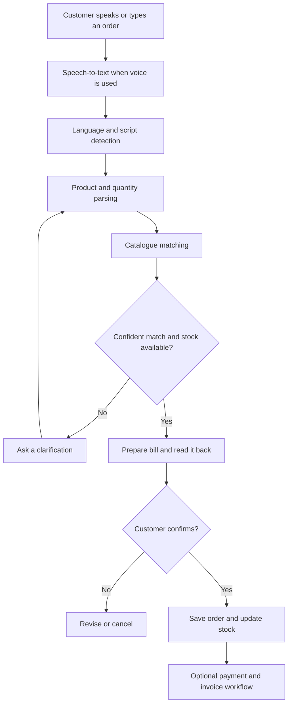

<div align="center">
  
  <h1>SWARA AI</h1>
  <p><strong>Every Voice. Smarter Commerce.</strong></p>
  <p>A multilingual, voice-powered commerce platform built for Indian Kirana stores.</p>
  <p>
    
    
    
  </p>
</div>

---

## Overview

SWARA AI helps neighbourhood grocery stores accept natural-language orders, recognise products, manage inventory and process orders through one integrated application. Customers can express an order in supported Indian languages or mixed-language phrasing; the system parses products and quantities, checks stock, prepares a bill and asks for confirmation before saving the order.

The platform also includes a store back-office for orders, customers, inventory, analytics, team access and payment records. It is designed around a practical principle: **when the system is uncertain, it should ask a clarifying question instead of silently choosing the wrong product.**

## Product capabilities

| Area | Capabilities |
|---|---|
| Multilingual ordering | Typed, recorded and WebSocket-streamed order input; configurable language options |
| Product understanding | Script detection, transliteration-aware matching, fuzzy catalogue search, quantity and unit parsing |
| Dialogue management | Context-aware clarification, stock checks, order review and explicit confirmation |
| Voice integration | Gnani Prisma speech-to-text and Gnani Timbre text-to-speech integration |
| Store operations | Dashboard, orders, customers, inventory, stock movements and analytics |
| Payments and billing | Cash records, UPI QR workflow, Razorpay test-mode integration, refunds and printable receipts |
| Access control | Owner and staff roles enforced by the server |
| Reporting | Searchable tables, CSV exports and operational analytics |

## How an order flows



## Technology

- **Backend:** Python, FastAPI, SQLAlchemy, WebSockets
- **Frontend:** React, TypeScript
- **Language and matching:** custom NLU pipeline, transliteration, RapidFuzz
- **Voice services:** Gnani Prisma and Gnani Timbre APIs
- **Data:** curated Open Food Facts India catalogue, relational application database
- **Quality:** PyTest, Vitest, Playwright browser checks

## Selected engineering details

- A catalogue pipeline reduced 21,751 raw Open Food Facts India rows to 5,325 usable products across 12 categories, with EAN-13 validation and provenance information.
- The held-out branded-product evaluation reports **81.3% exact product recognition** on 300 authored, typed sentences. This is a text-NLU result, not a speech-recognition accuracy claim.
- The parser reports p95 latency of **0.29 ms** in the project's recorded evaluation.
- The packaged verification report records 1,103 passing backend tests and 513 passing frontend tests, alongside browser checks. See the reports for scope and limitations.

## Screenshots

The repository includes real application captures under [`docs/screenshots/`](docs/screenshots/). Suggested highlights:

- Store dashboard and order desk
- Inventory and catalogue provenance
- AI performance and voice diagnostics
- Payment workflow, payment records and printable invoice

## Run locally

The repository's tested quick-start path targets Windows 10/11 and does not require Docker.

### Prerequisites

- Python 3.10 or newer
- Node.js is optional when using the included prebuilt frontend; use Node.js 20.19+ or 22.12+ to rebuild the frontend

### Windows quick start

```bat
setup.bat
```

Add your Gnani credential to `.env` as `GNANI_API_KEY` if you want to test live voice features, then run:

```bat
start.bat
```

Open `http://localhost:8000`. The first account created becomes the shop owner. Typing orders can be explored without a Gnani key; microphone-based speech recognition and spoken replies require the external service credentials.

For development with hot reload, use `dev.bat`. For the full installation guide, troubleshooting and configuration, see [`docs/INSTALLATION.md`](docs/INSTALLATION.md).

## Testing and verification

| Layer | Recorded result |
|---|---:|
| Backend PyTest suite | 1,103 passing tests |
| Frontend Vitest suite | 513 passing tests across 50 files |
| Browser verification | 221 browser checks, plus control audit |
| Held-out branded product matching | 244 / 300 exact matches (81.3%), typed text only |

Run the packaged test commands:

```bat
test.bat
```

Or run the frontend suite directly:

```bash
cd frontend
npm test
```

Detailed evidence: [`docs/VERIFICATION_REPORT.md`](docs/VERIFICATION_REPORT.md), [`docs/TESTING.md`](docs/TESTING.md), and [`docs/EVALUATION.md`](docs/EVALUATION.md).

## Important limitations

Transparency matters for a voice-commerce product. The packaged verification environment did **not** verify live calls to Gnani, microphone capture on real audio hardware, or speech accuracy. The Gnani request/response contract was tested using a simulator. Seven additional language rule sets are unit-tested but have not received native-speaker review. Razorpay was tested against a stand-in; no real Razorpay payment, refund or live-mode transaction was performed. UPI QR payments remain unverified until a person checks the actual payment in their banking app. The generated demo orders/customers and placeholder demo prices are clearly distinguished from real store data.

Read [`docs/LIMITATIONS.md`](docs/LIMITATIONS.md), [`docs/LANGUAGES.md`](docs/LANGUAGES.md), and [`docs/PAYMENT_TESTING.md`](docs/PAYMENT_TESTING.md) before interpreting results or configuring a live store.

## Repository guide

```text
backend/       FastAPI application, order engine, data and API logic
frontend/      React + TypeScript application
brand/         SWARA AI visual identity assets
data/          Catalogue and evaluation data
scripts/       Setup, verification, evaluation and maintenance scripts
docs/          Architecture, installation, screenshots, tests and reports
```

## Roadmap

- Validate each supported language with native speakers and real recordings.
- Measure speech recognition and end-to-end voice performance with live service credentials.
- Validate payment workflows with the relevant providers in their official test environments.
- Expand catalogue coverage and improve store-specific product and pricing onboarding.

## Attribution

The product catalogue is derived from Open Food Facts India data. Voice capabilities integrate with Gnani services. Review the source project documentation and the relevant third-party terms before redistribution or commercial deployment.

---

<div align="center">
  <strong>SWARA AI — Every Voice. Smarter Commerce.</strong><br />
  Built to make everyday commerce more accessible through language and technology.
</div>
