<p align="center">
  
</p>

<h3 align="center">Every Voice. Smarter Commerce.</h3>

**SWARA AI is an intelligent, multilingual, voice-powered commerce platform designed to simplify grocery ordering and digital operations for Indian Kirana stores.** It empowers Indian Kirana stores with multilingual voice ordering, intelligent product recognition, real-time inventory management, automated order processing, and actionable business insights.

A customer says *"mane 2 kilo chawal ane 1 litre doodh joie"* (Gujarati, Hindi, English, Hinglish, or a mix; since 2.3.0 also Marathi, Bengali, Tamil, Telugu, Kannada, Malayalam and Punjabi). The shop's assistant hears it with **Gnani Prisma**, works out the items, quantities and units, checks live stock, adds up the bill in paise, reads it back in the customer's language with **Gnani Timbre**, and saves the order only after a "yes". Around that sits a working shop back-office: dashboard, orders, customers, inventory, a product catalogue built from real public data, and analytics computed from the database.

There is a public landing page, real accounts (owner and staff roles, enforced by the server), and a signed-in back-office. Since 2.7.0 a confirmed order can also be **paid and billed**: cash, a UPI QR code, or Razorpay (test mode), with refunds, printable invoices and payment analytics.

| Dashboard | Order desk |
|---|---|
| 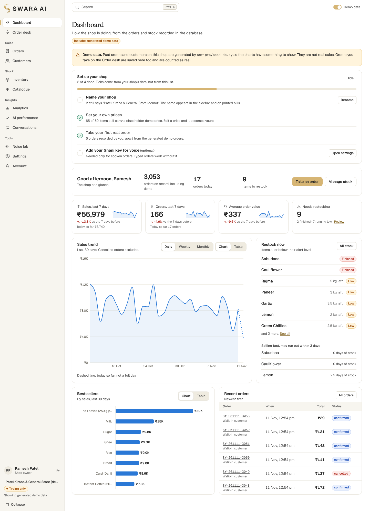 | 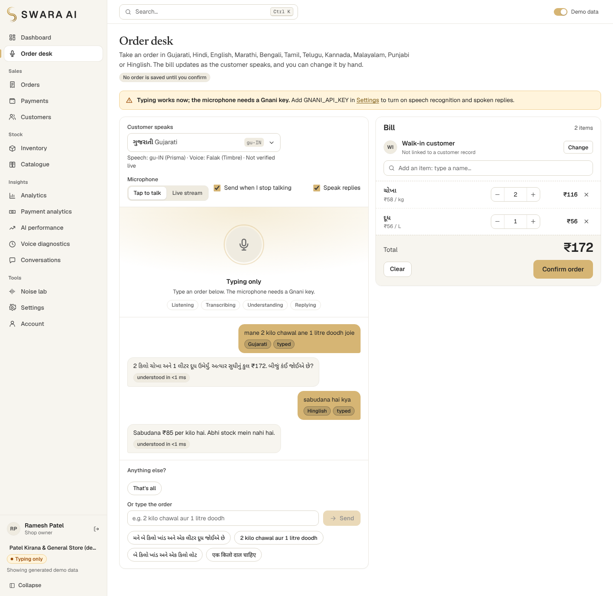 |
| **Analytics** | **Catalogue with provenance** |
| 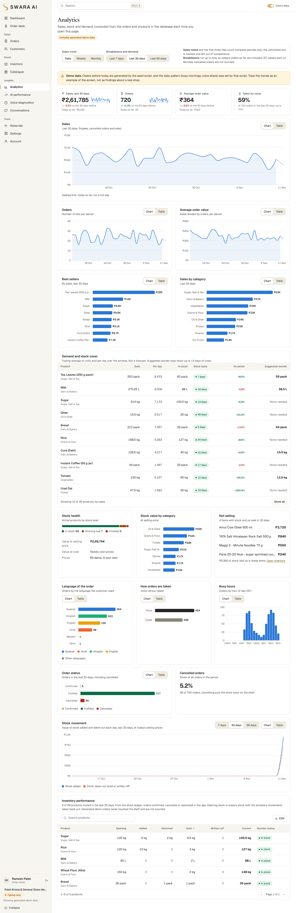 | 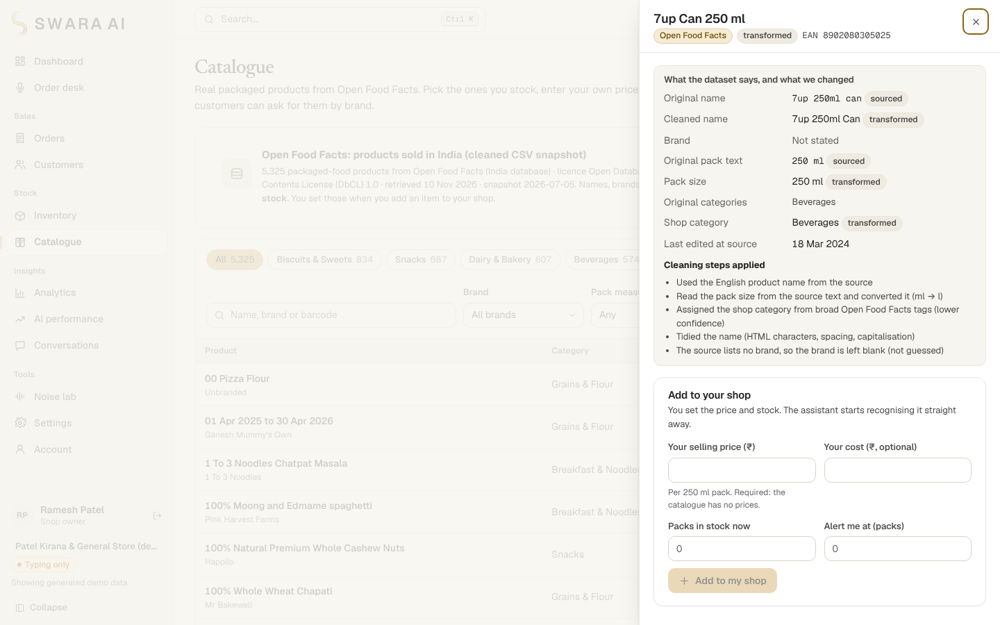 |
| **Orders** | **Phone** |
| 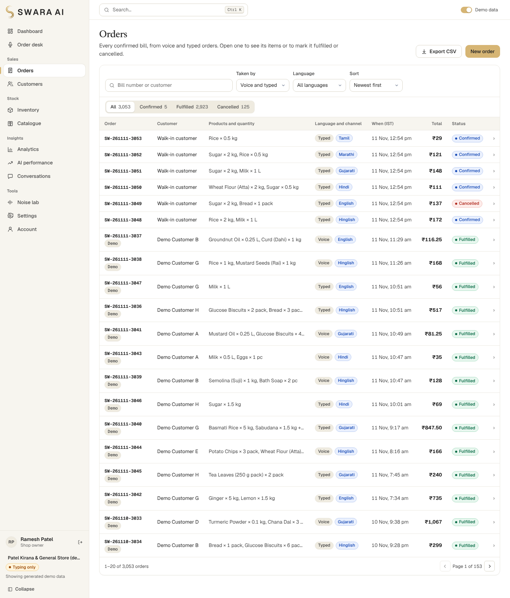 | 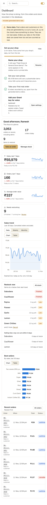 |
| **Landing page** | **Account** |
| 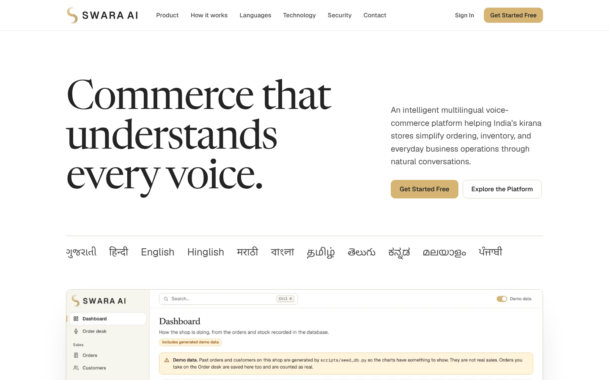 | 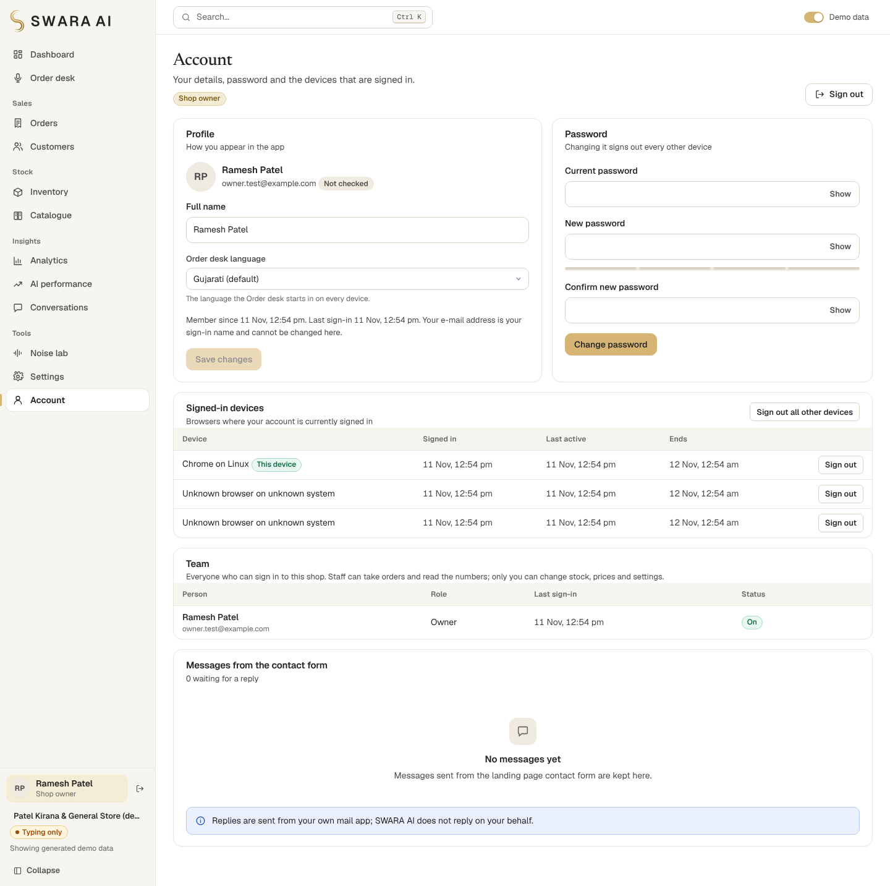 |
| **AI performance** | **AI performance on a phone (top of the page)** |
|  | 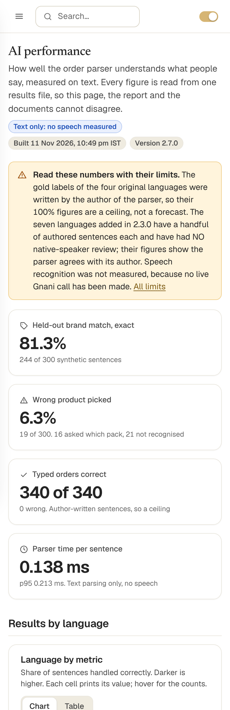 |
| **Voice diagnostics (owner only, before any spoken order)** | **Voice diagnostics on a phone (top of the page)** |
| 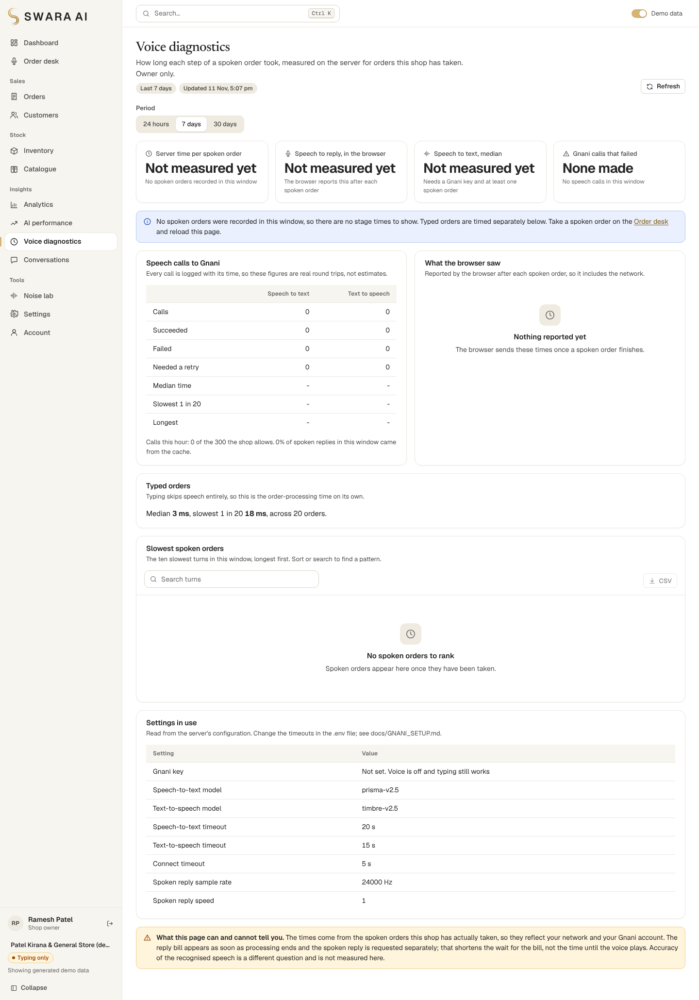 | 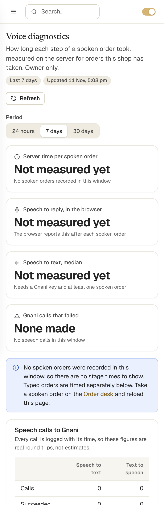 |
| **Take payment: choose a way (no Razorpay keys set, so Razorpay says why it is off)** | **UPI QR for the shop's own UPI ID: marked not verified until a person confirms** |
| 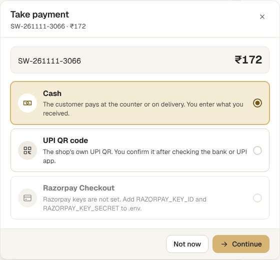 | 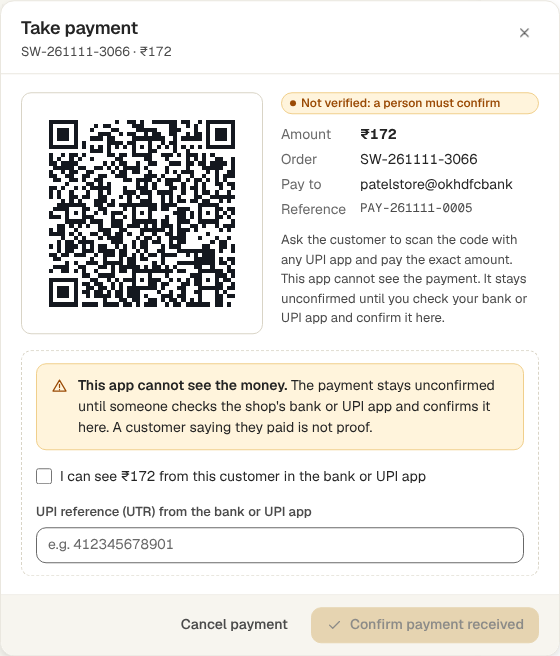 |
| **Payments** | **A payment with a refund and its activity trail** |
| 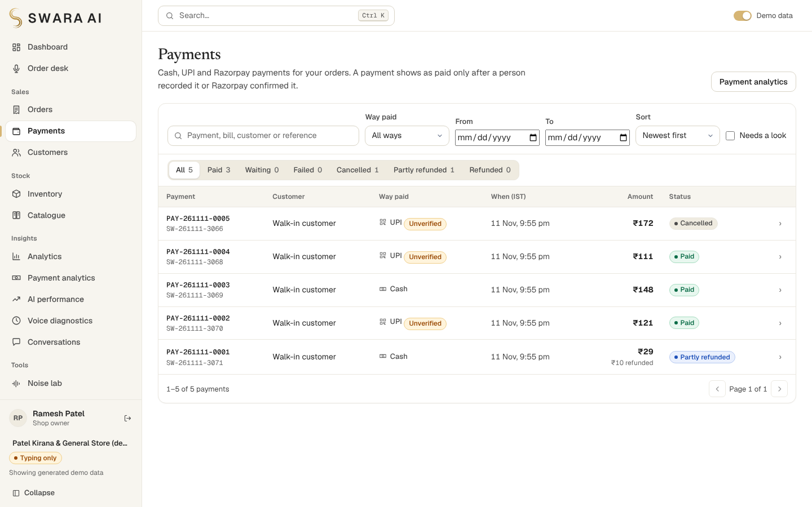 | 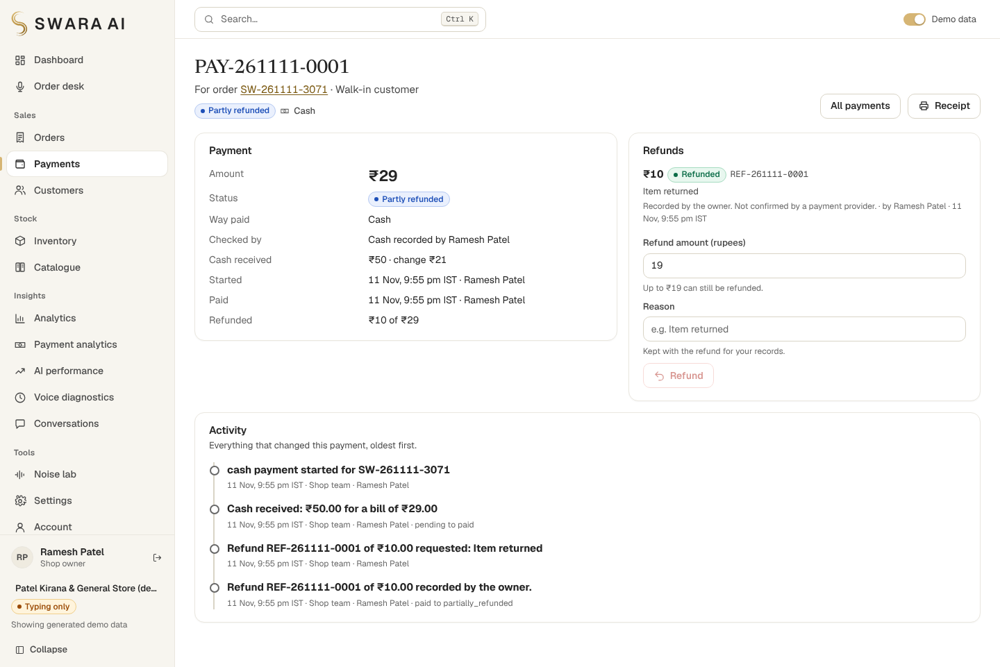 |
| **Payment analytics (owner only)** | **Invoice, as the browser prints it** |
| 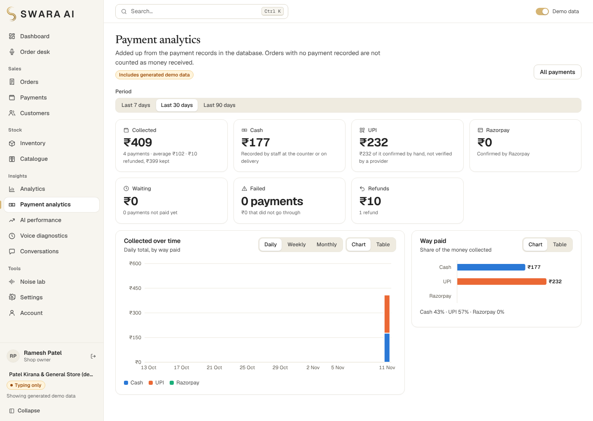 | 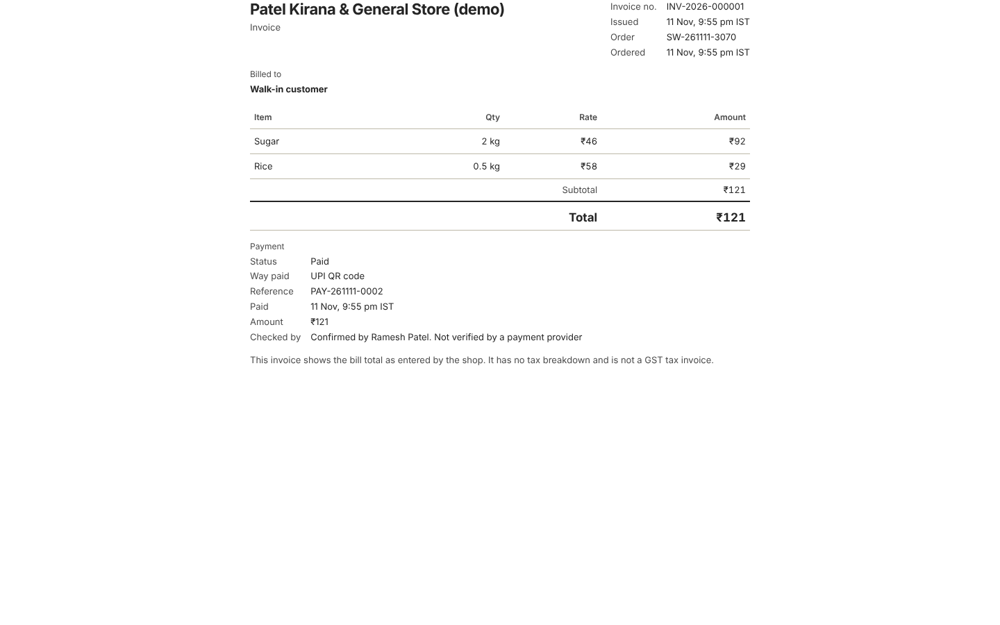 |

All screenshots in [`docs/screenshots`](docs/screenshots) are real captures of the running app, signed in as a throw-away owner account (`scripts/take_screenshots.py`). 49 are kept. 40-49 are the 2.7.0 payment screens (`scripts/take_payment_screenshots.py`, on a throw-away database with a few payments made through the app's own screens and API: no Razorpay keys, so nothing in them came from Razorpay; the money figures are those few demo payments, and the UPI ID in the QR pictures is an invented example, not a real account). All ten were retaken on the final 2.7.0 build; 14 captures were made (8 desktop and 6 phone) and the script reported no console error, failed request or HTTP error; 10 are kept. Desktop captures were taken at 1440 px and phone ones at 390 px (twice the pixels). For 2.6.0 the capture was repeated on a fresh database (62 captures at desktop, tablet and phone sizes: 22, 20 and 20; Chromium; no console error, failed request or HTTP error) and these were replaced or added: 02 and 18 (the Order desk), 04 (Analytics, which now shows the unfinished day beside its first three tiles) and the two new ones, 38 and 39 (Voice diagnostics at desktop and phone size; 39 is the top of the phone page). Voice diagnostics is shown **before any spoken order** because no Gnani key was available here, so every speech figure reads "Not measured yet"; the typed-order timing on it is real. For the 2.7.0 report, 02 (Order desk, with the 2.7.0 sidebar) and 36 and 37 (AI performance, whose parser timing changed) were retaken. The other signed-in pictures (01, 03 to 22, 38 and 39) were not retaken for 2.7.0, so their sidebar does not show the new Payments entries; 23–35 (the language selector and card, and the redesigned landing page) are the 2.4.0 captures, kept because those screens did not change. The orders and customers in them are **generated demo data**, labelled as such in the app; the stock-movement rows are from a few real typed orders placed by `scripts/demo_activity.py` on that throw-away database.

**Light theme only, by design.** There is no dark mode, no theme switch, and the interface stays light on a device that prefers dark. The palette is white `#FFFFFF`, ivory `#F7F5EF`, champagne gold `#D6B574`, text `#242424` and `#686868`, borders `#EAE7DF`, with accessible green and red for status. Contrast ratios computed from the real tokens are in [docs/test-results/contrast.txt](docs/test-results/contrast.txt); tests fail the build if a dark token, a `prefers-color-scheme: dark` rule or a dark literal colour comes back ([docs/DESIGN.md](docs/DESIGN.md)).

### What is new in 2.7

A payment and billing release. It upgrades the existing app: nothing was rebuilt, the voice-ordering path and the Gnani integration are unchanged, and updating keeps your `.env`, Gnani key, database, users, orders, customers and inventory ([docs/UPDATING.md](docs/UPDATING.md), [docs/MIGRATION_2.7.0.md](docs/MIGRATION_2.7.0.md)). **Nothing was run against the real Razorpay service and no live payment was made**: Razorpay was tested against a stand-in, and the first real test-mode payment is yours to make ([docs/RAZORPAY_SETUP.md](docs/RAZORPAY_SETUP.md)).

- **Take payment** on any confirmed order (Order desk and Orders):
  - **Cash**: the amount received, the change to give back, who recorded it and when.
  - **UPI QR code** for the shop's own UPI ID. The app cannot see the money, so it stays marked **Not verified** until a person has checked the bank or UPI app and confirmed it with a reference. A customer saying they paid is never proof.
  - **Razorpay Checkout** (UPI, cards, netbanking). **Off until you add keys**, starts in **test mode**, and live mode is never switched on by the update. The server creates the Razorpay order for the bill total it holds, checks the signature, asks Razorpay for the payment and compares amount, currency and order. The screen shows "paid" only when the server says so.
- **Payments** (search, way, dates, status, "Needs a look"), a **payment page** with its refunds and activity trail, owner-only **refunds** (a Razorpay refund stays "Waiting" until Razorpay confirms; cash and hand-confirmed UPI refunds are recorded as the owner's) and owner-only **Payment analytics**, summed from the payment records only.
- **Invoices**: a numbered receipt you can print or save as a PDF. **It is not a GST tax invoice**: no tax details are configured, no tax is calculated, and it says so.
- **Safe by construction**: signed webhook, each event processed once, one open payment per order (a database rule), refunds that can never exceed what was paid, payments that never change stock, owner and staff permissions enforced by the server, no secret ever sent to the browser ([docs/PAYMENT_SECURITY_AUDIT.md](docs/PAYMENT_SECURITY_AUDIT.md)).
- **Existing orders are untouched.** An order with no payment recorded reads "Not recorded", not "unpaid". Four new tables are added after a backup; `scripts/migrate_db.py` shows what would change before you let it.
- API: [docs/PAYMENTS_API.md](docs/PAYMENTS_API.md). Test results and what could not be run: [docs/PAYMENT_TESTING.md](docs/PAYMENT_TESTING.md).

### What is new in 2.6

A voice-response, diagnostics and reliability release. It upgrades the existing app: nothing was removed, nothing was rebuilt, and updating keeps your `.env`, Gnani key, database, users, orders and inventory ([docs/UPDATING.md](docs/UPDATING.md)). **No language was added and nothing was run against live Gnani**, so every language is still "Not verified live" and no real speech latency or accuracy was measured.

- **Reply first, voice after.** The Order desk puts the written reply and the bill on screen as soon as the order logic has run, then asks for the spoken reply separately. A voice that is slow or fails leaves the written reply in place. This is not streaming and does not make speech faster.
- **Voice diagnostics** (`/diagnostics`, owner only): the median and slowest-1-in-20 time for each step of a spoken order, the Gnani calls (how many, failed and why, retried), what the browser measured, the ten slowest orders and the time limits in force. Everything is read from rows the app wrote. Nothing is estimated, and an empty figure says "Not measured yet".
- **A hung speech service no longer holds an order for two minutes.** A call that was sent and got no answer is reported as a timeout and is not repeated: at most 20 s for speech to text and 15 s for text to speech, down from up to 121.5 s at the old defaults. One pooled connection is reused instead of one per call. Measured on a local stand-in, so the figures are simulated ([docs/PERFORMANCE_REPORT.md](docs/PERFORMANCE_REPORT.md)).
- **One state at a time on the Order desk** (Listening, Understanding, Preparing the voice, Replying), a plain message when nothing was heard, when the device is offline or when the speech service is slow, the recording **kept with Try again** after a failure that may pass, and an open bill that survives a reload.
- **The Demo data switch starts off for a shop with orders of its own** and on only for a shop with none. A choice made with the switch is kept. Nothing is deleted.
- **Defects found and fixed.** A silent recording could blank the open bill; the Settings page could leave `.env` half-written if the process died; a hung speech service was reported as a network error. Details: [CHANGELOG.md](CHANGELOG.md).
- Test results and what could not be run: [docs/TEST_REPORT_2.6.0.md](docs/TEST_REPORT_2.6.0.md).

### What is new in 2.5

An evaluation and verification release: one new screen, one generated report, one product-matching fix, and every figure traceable to a result file. **No language was added and nothing was run against live Gnani**, so every language is still "Not verified live".

- **AI performance** (`/performance`, signed in): the measured quality of the language engine on typed sentences, with the dataset and method beside each number, a held-out-brand confusion matrix by category, a language-label matrix, a per-language heat map, the noise-robustness curve with the spread over five seeds, and the test and verification record. Whatever was not measured (speech recognition, speech latency) says **"Not measured"**. Details: [docs/EVALUATION.md](docs/EVALUATION.md).
- **Tables you can work with**: search, sort, page and **CSV** on every table on that page, and a table view behind every chart. The numbers come from one file, `eval/results/evaluation_summary.json`, which a test rebuilds from the sentence files and the code, so a page or the report cannot show a number the code does not produce.
- **Stock movement** on Analytics (opening, added, sold, current and reorder status per product, from a stock ledger) and an order-status mix.
- **A generated project report** (`docs/PROJECT_REPORT.md`, `.docx`, `.pdf`): 23 sections, 14 numbered figures and 14 numbered tables, written from the result files by `scripts/build_report.py`. It describes version 2.7.0, including payments, refunds, invoices and the Razorpay stand-in.
- **A defect found and fixed.** A brand's pack-less alias ("amul butter") used to belong only to the pack imported first, so the shop was quietly sold that pack. Packs of one brand now share the alias and the assistant asks which pack. On 300 held-out branded sentences, wrong-product answers fell from 25 to 19 and exact matches went from 252 to 244 because 14 more sentences are now asked about (16 instead of 2): the assistant asks instead of guessing.
- **Order integrity and error leakage pinned down by tests** (no oversell, no duplicate order from two confirm presses, a bare 500 with no traceback). One limit is written down: the double-confirm guarantee relies on one server process ([docs/SECURITY.md](docs/SECURITY.md)).

### What is new in 2.4

A redesign of the public site, typography first. Only the front end changed: no API route, schema or table is different, and the signed-in screens keep their layout.

- **A new type system.** Display headings are set in **Newsreader** (a serif drawn for screens, SIL Open Font License) at a light weight, with **Geist** for text and controls and Noto Sans behind both for every Indian script. All fonts are bundled with the app; nothing is loaded from a font service. The page title of each signed-in screen uses the same serif.
- **A rebuilt landing page**: the headline "Commerce that understands every voice.", five product areas each laid out differently (typeset sample sentences, four spellings of one item, three arrangements of real screenshots), a live demonstration of the real language engine on typed text, an eleven-language ledger, the architecture and stack, security, FAQ and a contact form. It makes **no claim that any language was checked against live Gnani** (none was), and shows no customers, testimonials, certifications or performance numbers, because there are none.
- Same palette, one light theme, no dark sections. Details: [docs/DESIGN.md](docs/DESIGN.md); what was run and what was not: [docs/VERIFICATION_REPORT.md](docs/VERIFICATION_REPORT.md).

| Landing: voice ordering | Landing: product recognition |
|---|---|
| 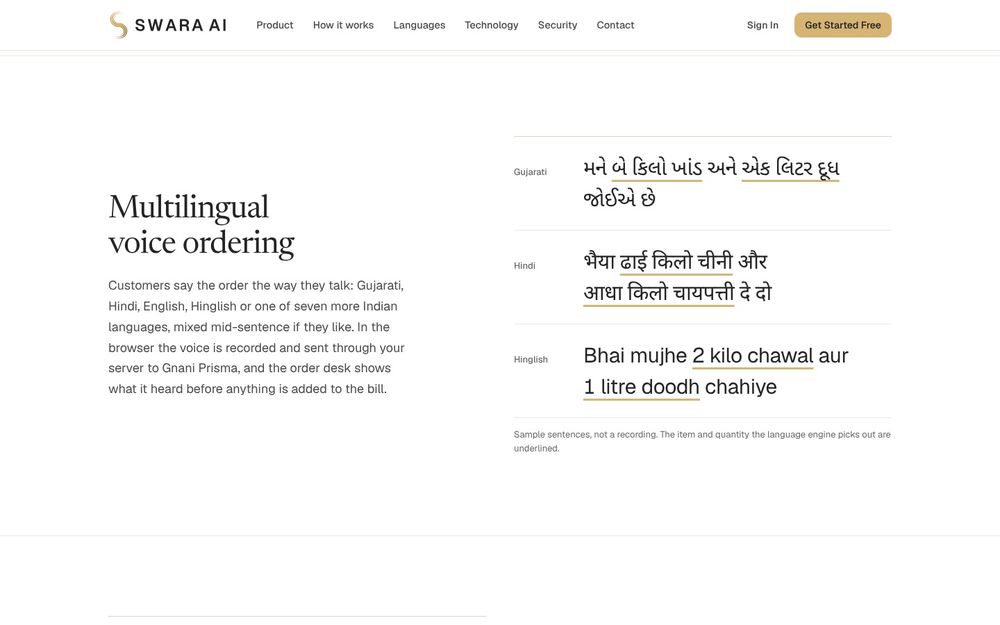 | 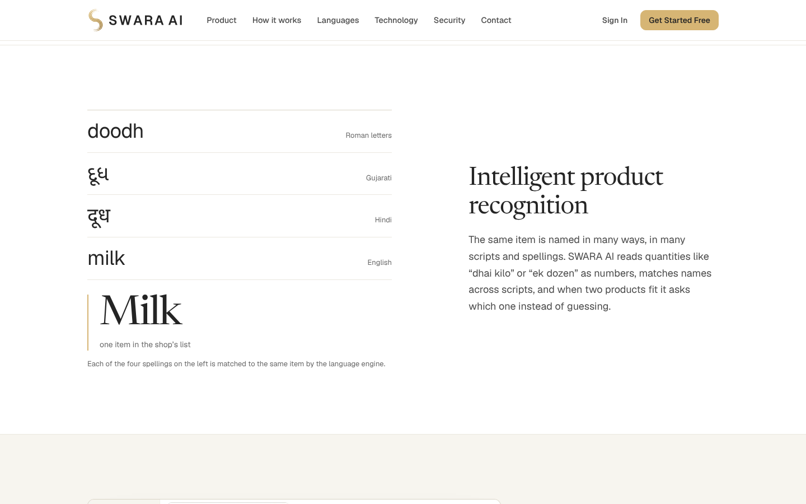 |
| **Landing: how it works (the live demo)** | **Landing: languages** |
| 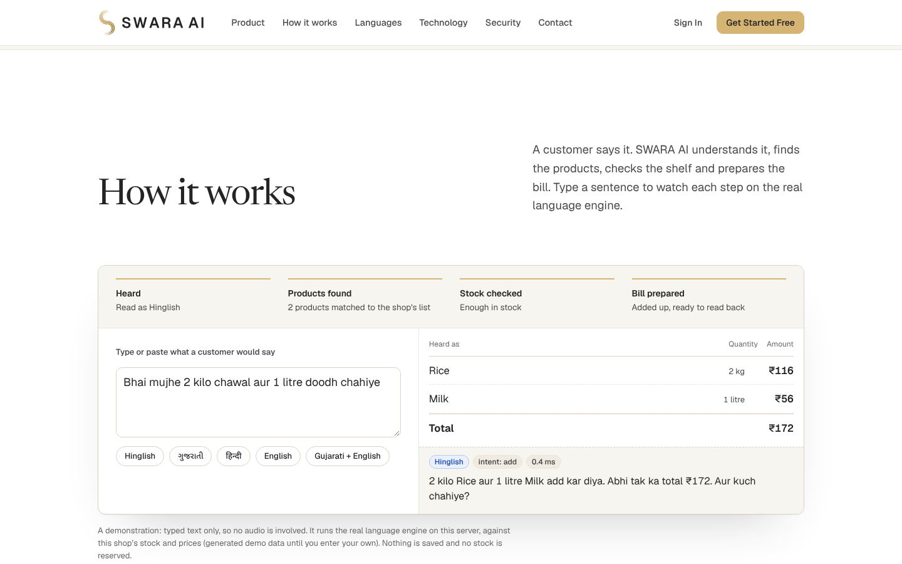 | 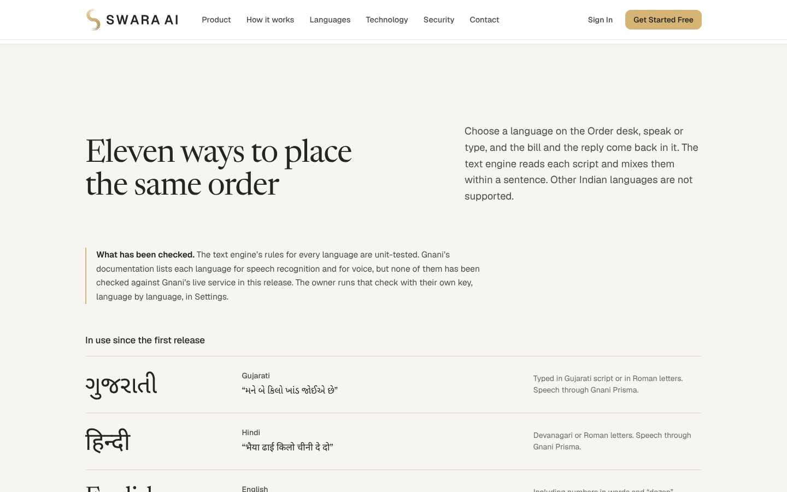 |

### What is new in 2.3

- **Eleven language choices on the Order desk**: the ten languages Gnani documents for Prisma v2.5 speech-to-text and Timbre v2.5 text-to-speech (Hindi, Indian English, Gujarati, Marathi, Bengali, Tamil, Telugu, Kannada, Malayalam, Punjabi) plus Hinglish. Gujarati, Hindi, English and Hinglish behave as before.
- **A polished language selector** and a **Settings → Languages and voices** card (switch languages on and off, pick a documented Timbre voice per language, test one language with two calls). One central table, `backend/app/languages.py`, drives all of it.
- **Honest status.** Every language shows **"Not verified live"** until you run `verify_gnani.bat`, which checks the voice, the language code and speech for each language **separately** and writes the result the app reads. The seven new languages are labelled as new: their understanding rules are unit-tested but **no native speaker has reviewed them and none has been compared with real Prisma output**. **Nothing in this repository says all the languages work, because that has not been tested against Gnani.**
- **Auto-detect is refused on Prisma v2.5** (it used to be silently treated as Gujarati). Unsupported or switched-off languages return a clear error; there is no fallback provider and no pretend audio.
- Details, the per-language table and what each test does and does not prove: [docs/LANGUAGES.md](docs/LANGUAGES.md).

| Language selector (open) | Settings → Languages and voices |
|---|---|
| 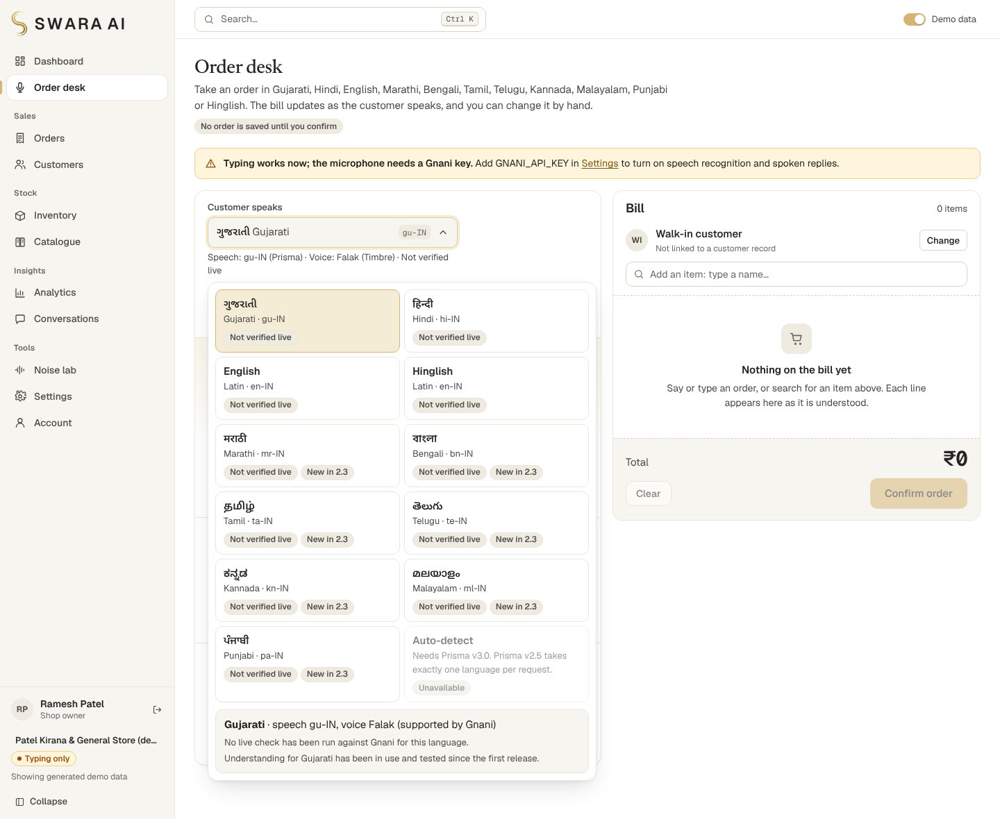 | 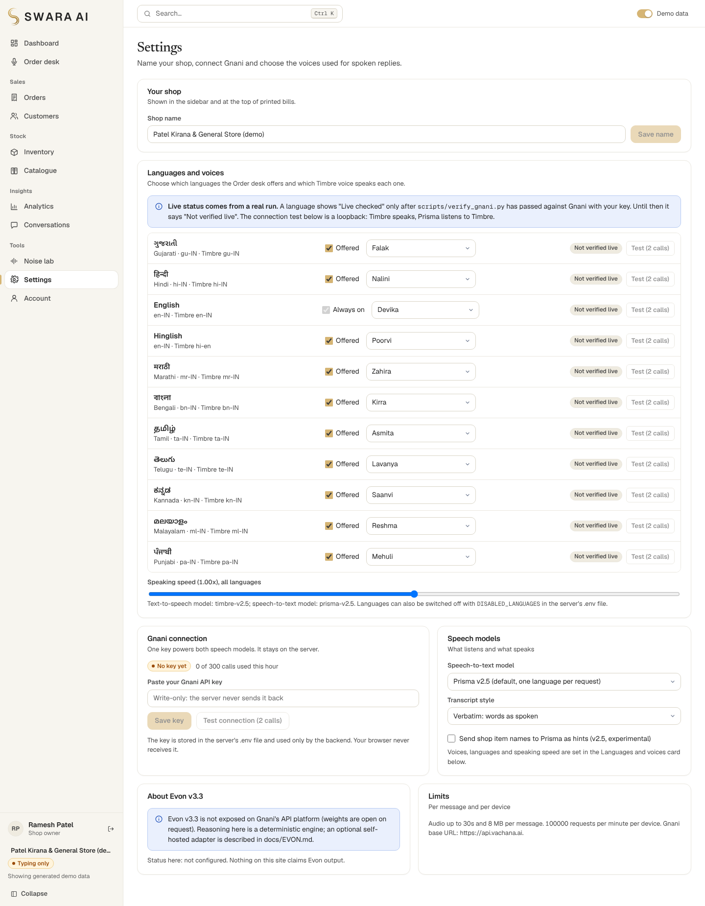 |

### What is new in 2.2

- **Presented as an independent product.** Wording that tied the project to a one-off programme is gone from the app, the docs and the report; the technical credits to Gnani (Prisma for speech recognition, Timbre for spoken replies) and the "not affiliated" line stay. A test guards this.
- **A working API reference at `/docs`.** FastAPI's own page was blank under the app's strict security policy; it is replaced by a small local page that lists every route (`API_DOCS=false` switches it off).
- **One-time links are redacted in the server's access log** (`token=[redacted]`).
- **Windows scripts** check the Node version and a busy port and say what to do. They are still **not run on Windows**.
- **New documents:** database, troubleshooting, development guide, Gnani setup and verification, third-party notices, changelog, and a verification report that separates what was run from what was not. Full list: [CHANGELOG.md](CHANGELOG.md).

### What is new in 2.1

- **Export CSV** on Orders (the current filter), Inventory and Customers (owner only): UTF-8 with a byte-order mark so Excel reads rupees and Gujarati/Hindi names, formula-injection guard, IST times, a 20,000-row cap that says when it truncates.
- **Print bill** from an order's drawer: a clean single-bill page, only the bill is printed.
- **Shop name** editable by the owner in Settings; it appears in the sidebar and on printed bills and is kept in `.env`.
- **Setup checklist** on a new owner's dashboard, with ticks computed from the shop's data.
- **Security and trust** section on the landing page: six things the code does, and an explicit "what we do not claim".
- **Final polish pass**: the landing pictures and all documentation screenshots were retaken from the light-only app; remaining dark-theme traces and a stale reference in the deployment notes were removed. No existing feature was removed.

---

## Read this first: what is verified and what is not

| | Status | Evidence |
|---|---|---|
| Backend, database, inventory, order engine, analytics, accounts | **Tested here** | 1,103 pytest tests pass ([log](docs/test-results/backend_pytest.txt)); 95% line coverage (6,349 statements, 297 not executed). All Gnani and Razorpay responses in them are simulated |
| Frontend (React + TypeScript strict) | **Tested here** | 513 Vitest tests in 50 files pass; `tsc --noEmit` and the production build are clean ([log](docs/test-results/frontend_vitest.txt)). There is no ESLint configuration, so no lint run exists |
| Payments (2.7.0): cash, UPI QR confirmed by a person, refunds, invoices and print layout, payment analytics, owner and staff permissions, migration of an existing database | **Tested here**: automated tests, and a real browser run against a fresh database and an update of a database made by the released 2.6.0 code (`scripts/check_update_in_place.py`: 34 of 34 checks, [log](docs/test-results/update_in_place_check.txt)) | [docs/PAYMENT_TESTING.md](docs/PAYMENT_TESTING.md) |
| **Razorpay: real API calls, Checkout in a browser, webhook delivery from Razorpay, real refunds, the optional Razorpay UPI QR, live mode** | **NOT verified.** No Razorpay account or network route in the build environment: everything was tested against a stand-in that returns the replies the code expects. **No payment of any kind went through Razorpay** | The checklist in [docs/RAZORPAY_SETUP.md](docs/RAZORPAY_SETUP.md); what is and is not covered in [docs/PAYMENT_SECURITY_AUDIT.md](docs/PAYMENT_SECURITY_AUDIT.md) |
| **GST tax invoices** | **Not provided, by design.** No merchant tax details are configured and no tax is calculated; the invoice says it is not a GST tax invoice | [docs/PAYMENTS_API.md](docs/PAYMENTS_API.md) |
| Sign-up, sign-in, sign-out, protected pages, wrong password, lock-out, session expiry, owner vs staff, no horizontal scrolling at 7 widths, every enabled button and link on 21 pages, the payment, refund, invoice and permission screens | **Run here** in headless Chromium against a real server and a throw-away database | 221 browser checks (61 more than in 2.6.0, all for payments, refunds, invoices, permissions and the payment screens, one of them the width sweep widened to the payment pages; also the Voice diagnostics page, the Demo data default, the AI performance page, stock movement, the CSV download and a width sweep over 20 pages and the payment window) and a 4-check button/link audit (10 + 221 buttons clicked, links on 21 pages), all passed on the final build ([main](docs/test-results/e2e_browser_main.txt), [audit](docs/test-results/e2e_browser_controls.txt)); the runs that found bugs along the way are described in [docs/TESTING.md](docs/TESTING.md) |
| Dependency vulnerabilities | **Checked here** on the day of packaging | `npm audit`: 0; `pip-audit`: none found ([docs/SECURITY.md](docs/SECURITY.md)) |
| Screens at desktop, tablet and phone sizes, **light theme only** | **Checked here** in headless Chromium | 62 captures with no console error, failed request or HTTP error (`scripts/take_screenshots.py`, retaken for 2.6.0 and not repeated for 2.7.0) and 14 captures of the payment screens with none either (`scripts/take_payment_screenshots.py`, 2.7.0); the light-only rule is also checked by tests and by the browser run, which emulates a device that prefers dark |
| Printing a bill and the CSV downloads | **Checked here** in Chromium: the print layout (a PDF render, with print media emulated) and real file downloads. **NOT checked:** a real printer, or opening the CSV in Excel or Google Sheets | [docs/TESTING.md](docs/TESTING.md) |
| Language understanding (Gujarati, Hindi, English, Hinglish, mixed) | **Measured here** on 288 authored utterances, and on 300 held-out branded-product sentences (244 exact, 81.3%; 19 wrong product; 21 not recognised; 16 asked which pack). Typed text only: **no speech was measured** | [docs/EVALUATION.md](docs/EVALUATION.md), and the **AI performance** screen |
| Language understanding for the **seven added languages** (Marathi, Bengali, Tamil, Telugu, Kannada, Malayalam, Punjabi) | **Unit-tested only.** Rules written for 2.3.0 by the project author, tested with sentences the same author wrote. **No native-speaker review, no measured accuracy, never compared with real Prisma output** | [docs/LANGUAGES.md](docs/LANGUAGES.md) |
| Product catalogue | **Real, public data** (5,325 Indian products, Open Food Facts, ODbL). **It contains no prices.** | [docs/DATA.md](docs/DATA.md) |
| Gnani request/response contract (STT, TTS, streaming) | Tested against a **simulator built from Gnani's docs** | `backend/tests/test_gnani_contract.py`, `test_ws_proxy.py` |
| **Live calls to Gnani Prisma / Timbre, for each of the 11 languages** | **NOT verified** in the build environment (no network route to Gnani, no API key). The app shows every language as "Not verified live" until you run the check. **This repository does not claim that all 10 Gnani languages work** | Run `verify_gnani.bat` with your key; for real recognition add a recording of a person per language ([docs/LANGUAGES.md](docs/LANGUAGES.md)) |
| **Microphone capture in a real browser** | **NOT verified** (no audio hardware in the build environment) | Try it on your machine |
| **Windows setup scripts** | **NOT run on Windows** (built on Linux). Reviewed again for 2.5.0; tests check their line endings, that every `goto` has a label, that every file they point at exists and that none holds a key | Run them and see [docs/INSTALLATION.md](docs/INSTALLATION.md); [docs/TROUBLESHOOTING.md](docs/TROUBLESHOOTING.md) if one fails |
| **E-mail** (password-reset and verification links, contact notices) | Code and flows **tested against a local test mail catcher only**. **NOT verified against a real provider** | Needs your `SMTP_*` settings; until then the app says plainly that no e-mail is sent ([docs/AUTHENTICATION.md](docs/AUTHENTICATION.md)) |
| **Sign in with Google or another provider (OAuth)** | **Not built** | The sign-in page offers e-mail and password only; there is no button that pretends to work ([docs/AUTHENTICATION.md](docs/AUTHENTICATION.md) says what adding a provider would need) |
| **Running behind https and a reverse proxy** | **NOT verified** with a real certificate or proxy; the https cookie and header behaviour is tested in code | [docs/DEPLOYMENT.md](docs/DEPLOYMENT.md) |
| **Screen reader, axe or Lighthouse audit; browsers other than Chromium** | **NOT done** | Keyboard operation, focus handling and contrast are built in and unit-tested; see [docs/DESIGN.md](docs/DESIGN.md) |
| Evon v3.3 | **Not used.** It is not on Gnani's public API. | [docs/EVON.md](docs/EVON.md) |

**About the data in the app.** Product names, brands, pack sizes and categories are real (Open Food Facts). **Prices are not**: the 65 curated staples carry placeholder demo prices, and an item imported from the catalogue is only added once you type its price. **Orders and customers are synthetic** (about 120 days, generated by a seeded script) so the charts have something to show; they are marked "Demo" in the interface and a **Demo data** switch removes them from every view. Analytics are exact sums over the database rows, so they will describe your real shop as soon as it has real orders.

No number in this repository comes from a Gnani call unless a script in `scripts/` made that call on your machine. See [docs/LIMITATIONS.md](docs/LIMITATIONS.md).

---

## Quick start (Windows 10/11, VS Code, no Docker)

You need **Python 3.10+** (tested on 3.13). Node.js is optional: a prebuilt frontend is included in release zips (to rebuild it you need Node 20.19+ or 22.12+).

```bat
setup.bat          :: once: virtual env, packages, .env, demo database
notepad .env       :: paste GNANI_API_KEY=...   (or add it later on the Settings page)
start.bat          :: starts the app and opens http://localhost:8000. Choose Get Started Free: the FIRST account you create is the shop owner
verify_gnani.bat   :: about 33 real Gnani calls (11 languages x 3): checks voice, language code and speech for each language separately. Run this first.
```

Everything except the landing page, the Terms and the Privacy page needs a signed-in person ([docs/AUTHENTICATION.md](docs/AUTHENTICATION.md)). No e-mail is needed to sign up on your own computer. Typing orders works without a Gnani key. The microphone, Prisma speech recognition and Timbre spoken replies need your `GNANI_API_KEY`.
Full walkthrough and troubleshooting: [docs/INSTALLATION.md](docs/INSTALLATION.md).

Developer mode (hot reload): `dev.bat`, then open http://localhost:5173. All tests: `test.bat`.

**Updating an install you already use?** Do not start again from a fresh folder. The release ZIP holds no `.env` and no database, so extracting it over your project keeps your `.env`, your Gnani key, your users, orders and inventory; the only database change is one added column. Take a copy of `.env` and `backend\data` first, run `setup.bat` again, then `start.bat`. The steps, the checks, the new optional timeout settings and how to go back are in [docs/UPDATING.md](docs/UPDATING.md). Never run `seed_db.py --reset` on a shop's data.

---

## Tests

| Layer | How to run | What it covers |
|---|---|---|
| Backend (pytest) | `test.bat`, or `cd backend && .venv\Scripts\python -m pytest` | 1,103 tests: language engine, ordering and stock rules, accounts and sessions, security, Gnani contract against a simulator, the voice path and diagnostics, exports, evaluation summary, payments, refunds, invoices and the 2.7.0 migration |
| Frontend (Vitest) | `cd frontend && npm test` | 513 tests in 50 files, plus `tsc --noEmit` and the production build (`npm run build`) |
| Real browser (Playwright) | `python scripts/e2e_browser.py http://127.0.0.1:8000 --db <throw-away db> --owner-email you@example.com` | Sign-up, sign-in, lock-out, owner vs staff, every enabled button and link, widths from 320 to 1440 px, the AI performance page, stock movement, CSV download. Needs Chrome and `pip install playwright`; use a **fresh** database |

Run counts, dates and what was **not** run (live Gnani, a real microphone, Windows, a real mail server) are in [docs/TESTING.md](docs/TESTING.md) and [docs/VERIFICATION_REPORT.md](docs/VERIFICATION_REPORT.md).

---

## What you must supply (external credentials and services)

Nothing here is bundled, and nothing pretends to work until you provide it.

| You supply | Needed for | Where it goes | Without it |
|---|---|---|---|
| **Gnani API key** (`GNANI_API_KEY`) | Voice: Prisma speech recognition and Timbre spoken replies | `.env`, or the Settings page (owner only) | Typed orders work; the microphone and spoken replies are unavailable and say so |
| **SMTP details** (`SMTP_HOST` and `SMTP_FROM` both, plus `SMTP_PORT`, `SMTP_USER`, `SMTP_PASSWORD`, `SMTP_SECURITY`) from any mail provider you already use | Password-reset links, e-mail verification, contact-form notices (`CONTACT_TO`) | `.env`; then check it with `scripts/auth_admin.py test-mail --to you@example.com` | **No e-mail is ever sent** and the app says so. Sign-up still works; the owner resets passwords from the command line; messages from the contact form are kept in the Account page |
| `STORE_NAME` (optional) | The shop's name on the sidebar and printed bills | Set it on the Settings page (the owner can rename the shop; it is saved to `.env`) or in `.env` | The demo name "Patel Kirana & General Store (demo)" is shown, and the dashboard checklist asks you to rename it |
| **`OWNER_EMAIL`** | Deciding who becomes the owner on a server others can reach | `.env` | The first account created becomes the owner |
| **`PUBLIC_URL`** (and a domain with an https certificate, behind a reverse proxy) | Putting the app on the internet: links in e-mails, the secure cookie, canonical address and share-card tags in the built landing page (set it **before** `npm run build`) | `.env` and the build environment; [docs/DEPLOYMENT.md](docs/DEPLOYMENT.md) | Fine on your own computer (`http://localhost:8000`) |
| OAuth client ID and secret from Google, Microsoft or another provider | Only if you add social sign-in | **Not built**, so there is nowhere to put them yet | E-mail and password sign-in only |

## What is in the app

| Screen | What it does |
|---|---|
| **Landing page** (`/`) | The public front door: what the product does, a live "try it" box that runs the real parser, how it works, the languages, the technology, a **Security and trust** section that also says what is *not* claimed, what is built and what is only planned, FAQ, contact form. It shows real screens of the app and **no invented customers, partners or numbers** |
| **Sign up, sign in, forgot / reset password, verify e-mail** | Real accounts on the existing backend. Show/hide password, strength guide, "keep me signed in", return to the page you asked for, a clear message when a session ends |
| **Account** | Your name, change password, the devices you are signed in on (sign out one or all). The owner also sees the team and the contact inbox |
| **Dashboard** | Today so far, the last 7 days, sales trend, best sellers, restock list, recent orders. Every tile is a query over the orders table. A new owner also gets a four-step **setup checklist** whose ticks come from the shop's own data (shop renamed, own prices, a first real order, an optional Gnani key) and that can be hidden |
| **Order desk** | Pick the customer's language from the selector (11 choices, each with its Gnani code and an honest status), then speak, stream or type an order; live bill with editable quantities, a customer picker, read-back and confirm. The assistant's question is answered before anything else can be pressed |
| **Orders** | Search, status tabs with counts, channel and language filters, paginated; a drawer with the bill, the conversation, **Print bill** and cancel (stock returns once); **Export CSV** of the current filter. Filters live in the URL, so a view can be bookmarked |
| **Customers** | List with order counts and spend; drawer with history; add and edit; owner-only **Export CSV** |
| **Inventory** | Server-side search, filter, sort and pagination; stock and price-basis badges; restock and edit; valuation at selling price; **Export CSV** |
| **Catalogue** | The 5,325 public products with search and facets; a provenance drawer showing the raw source value next to the cleaned one; add to shop with your own price |
| **Analytics** | Sales by day, week or month; AOV; category and language mix; busy hours; demand and days of cover; inventory valuation. Stock movement per product and an order-status mix. Every chart has a Table view. Comparisons are shown only when the earlier period is complete enough, otherwise the page says so |
| **AI performance** | How well the language engine understands typed orders, with the dataset and method beside every number: metrics, per-language results, confusion matrices, noise robustness, the test record and the stack. Sortable, searchable, paged tables with CSV; anything not measured says "Not measured" |
| **Conversations** | Each voice or text conversation as a timeline with the measured latency of every model call |
| **Noise lab** | Add hiss, rumble, crowd or hum at a chosen SNR, listen, then run Prisma on each version |
| **Settings** | The **shop name** (shown in the sidebar and at the top of printed bills), a write-only API key with a connection test, **Languages and voices** (switch each language on or off, choose its Timbre voice, test it). Staff can look but not change |

Also: command palette (`Ctrl/⌘ K`) with global search across products, orders, customers and the catalogue; a skip link; keyboard-operable tables, drawers and tabs; reduced-motion support; layouts checked at 1440, 820 and 390 px wide. Design notes: [docs/DESIGN.md](docs/DESIGN.md).

## The 14 features and where they live

| # | Feature | Where |
|---|---|---|
| 1 | Multilingual voice ordering (11 languages, see [docs/LANGUAGES.md](docs/LANGUAGES.md)) | Order desk, *Tap to talk*: browser WAV → `/api/voice/turn` → Prisma → dialogue → Timbre |
| 2 | Real-time speech-to-text | Order desk, *Live stream*: browser PCM → `/ws/voice` proxy → `wss://api.vachana.ai/stt/v3/stream` |
| 3 | Product recognition | `backend/app/nlu/lexicon.py`: exact → cross-script phonetic skeleton → fuzzy; covers the 65 staples and any imported branded product |
| 4 | Quantity extraction | `backend/app/nlu/parser.py`: "dedh kilo", "ढाई", "sava", "half a kilo", "બે", digits |
| 5 | Indian-language and Hinglish handling | Gujarati, Devanagari, Bengali, Gurmukhi, Tamil, Telugu, Kannada and Malayalam mapped to one roman skeleton, so *doodh / દૂધ / दूध* are one word |
| 6 | Inventory management | Inventory screen; stock drops atomically on confirm and returns on cancel |
| 7 | Price calculation | Integer paise and `Decimal` quantities; half-up rounding; no floats in money |
| 8 | Voice confirmation | Read-back of the bill, yes/no/add more/cancel, spoken with Timbre |
| 9 | Order history | Orders screen: search, filters, line items, fulfil/cancel |
| 10 | Admin dashboard | Dashboard and Analytics screens on real database rows, with a table view for every chart |
| 11 | Low-stock notifications | Banner and list on Inventory and Dashboard, alerts returned after each confirmed order, stock-out risk in Analytics |
| 12 | Customer summary | The spoken and written order summary, the bill ledger before confirmation, and the Customers screen |
| 13 | Text fallback | Every voice path also works by typing; same pipeline |
| 14 | Noisy-audio testing mode | *Noise lab*: add hiss/rumble/crowd/hum at a chosen SNR and a phone-line filter, listen, then run Prisma on each version |

## How the Gnani models are used

| Model | Used for | Notes |
|---|---|---|
| **Prisma v2.5** (default) / v3.0 (optional) | Speech to text, REST `POST /stt/v3` and streaming | One language code per request on v2.5 (10 documented codes); v3.0 adds auto language, which the app offers only when configured for v3.0 |
| **Timbre v2.5** | Spoken replies, `POST /api/v1/tts/inference` | 11 `language` values and the 42 documented v2.5 voices; a voice per language; replies cached on disk |
| Evon v3.3 | **Not used** | Not exposed on Gnani's public API. Decisions come from a deterministic engine you can read and test |

Details, request shapes and error handling: [docs/MODEL_INTEGRATION.md](docs/MODEL_INTEGRATION.md).

## Architecture and technology stack

```
Browser (React + TypeScript)         one FastAPI process                         outside
 microphone / typed text    ──REST──▶  routers ─▶ pipeline.process_turn ─▶ NLU   Gnani Prisma (speech to text)
 order desk, back-office    ──WS────▶  /ws/voice proxy                    │      Gnani Timbre (text to speech)
                                       order service (atomic stock) ◀──────┘     (the key stays on the server)
                                       SQLite (orders, stock ledger, accounts)
```

One server process serves the API, the WebSocket proxy and the built web app; Gnani is the only external service and the browser never sees the key. The language engine (`backend/app/nlu/`) and the money and stock rules are plain Python, so they can be tested without any model. Full diagrams, dialogue states and the data model: [docs/ARCHITECTURE.md](docs/ARCHITECTURE.md).

| Part | Technology |
|---|---|
| Server | FastAPI, SQLAlchemy and SQLite, pydantic, httpx, rapidfuzz, numpy |
| Accounts | scrypt password hashing, server-side sessions in an HttpOnly cookie, CSRF token |
| Web app | React 18, TypeScript (strict), Vite 7, React Router 7, Recharts 3, fonts self-hosted (Newsreader, Geist, Noto Sans Indic) |
| Speech | Gnani Prisma v2.5 (speech to text), Gnani Timbre v2.5 (text to speech). Both implemented and tested against a simulator; **not verified live** |
| Data | Open Food Facts India extract (5,325 products, ODbL) |
| Tests | pytest, Vitest, Playwright for Python with Chrome |

The same table with versions and an implementation status for each row is Table 1 of the [project report](docs/PROJECT_REPORT.md) and appears on the **AI performance** screen.

## Data

Four kinds of data, never mixed up in the UI or the files:

| Kind | What | Where |
|---|---|---|
| **Sourced** | The Open Food Facts India extract, unedited: 5,325 packaged products (barcode, brand, name, pack size, category). ODbL 1.0 / DbCL 1.0, snapshot of 5 Jul 2026, retrieved 10 Nov 2026, sha256 recorded | `data/raw/`, `data/sources/MANIFEST.json` |
| **Transformed** | Cleaned names, parsed pack sizes, shop categories, a deterministic 90/10 train/test split, each by a listed rule | `data/processed/`, `scripts/data/` |
| **Curated** | The 65 staples with names in three languages, spoken aliases and reorder levels, written by hand | `backend/app/seed_data.py` |
| **Synthetic** | Demo orders and customers, demo prices, test sentences. Labelled "Demo" | `backend/app/seed.py`, `data/test/` |

Full provenance, licences, the AGPL caveat on the retrieval route, what could not be downloaded and why: [docs/DATA.md](docs/DATA.md). Rebuild or update the catalogue on a machine with internet: `python scripts/data/fetch_sources.py`, then `python scripts/data/update_catalog.py`.

## Documentation

| Document | What is in it |
|---|---|
| [CHANGELOG.md](CHANGELOG.md) | What changed in each version |
| [docs/INSTALLATION.md](docs/INSTALLATION.md) · [docs/GNANI_SETUP.md](docs/GNANI_SETUP.md) · [docs/TROUBLESHOOTING.md](docs/TROUBLESHOOTING.md) | Windows setup with every command, configuring and proving the Gnani key, what to do when something fails |
| [docs/DEVELOPMENT.md](docs/DEVELOPMENT.md) · [docs/DATABASE.md](docs/DATABASE.md) | Working on the code (layout, conventions, adding an endpoint or a page); the tables, money and stock rules, backups |
| [docs/VERIFICATION_REPORT.md](docs/VERIFICATION_REPORT.md) | What was run for this release, what passed, and what was **not** verified |
| [docs/UPDATING.md](docs/UPDATING.md) | Updating an existing install without losing `.env`, the Gnani key, the database, users, orders or inventory; environment migration; rolling back |
| [docs/RAZORPAY_SETUP.md](docs/RAZORPAY_SETUP.md) · [docs/PAYMENTS_API.md](docs/PAYMENTS_API.md) | Payments (2.7.0): turning Razorpay on in **test mode** step by step, with the test-mode checklist that closes what could not be checked here; every payment, refund, invoice and webhook endpoint |
| [docs/PAYMENT_TESTING.md](docs/PAYMENT_TESTING.md) · [docs/PAYMENT_SECURITY_AUDIT.md](docs/PAYMENT_SECURITY_AUDIT.md) | What was run for payments and what was **not** verified (nothing reached Razorpay); the payment security review and its known risks |
| [docs/MIGRATION_2.7.0.md](docs/MIGRATION_2.7.0.md) · [docs/CHANGED_FILES_2.7.0.md](docs/CHANGED_FILES_2.7.0.md) | The database change in 2.7.0 (backup, four new tables, how to check it first, how to go back) and every file that changed since 2.6.0 |
| [docs/PERFORMANCE_REPORT.md](docs/PERFORMANCE_REPORT.md) | 2.5.0 against 2.6.0 on the voice path: what was measured, on a local stand-in, and what was not |
| [docs/TEST_REPORT_2.6.0.md](docs/TEST_REPORT_2.6.0.md) | The 2.6.0 testing report: suites run, counts, and what could not be run |
| [docs/CHANGED_FILES_2.6.0.md](docs/CHANGED_FILES_2.6.0.md) | Every file that changed between 2.5.0 and 2.6.0, grouped by area |
| [THIRD_PARTY_NOTICES.md](THIRD_PARTY_NOTICES.md) | Licences of the bundled data, fonts and dependencies |
| [docs/AUTHENTICATION.md](docs/AUTHENTICATION.md) | Accounts, roles, sessions, e-mail setup, what is **not** built |
| [docs/SECURITY.md](docs/SECURITY.md) | The security review: what was found, fixed, checked by running it, and left as a known risk |
| [docs/DEPLOYMENT.md](docs/DEPLOYMENT.md) | Putting it on a reachable server: checklist, https, reverse proxy samples (untested), backups |
| [docs/DATA.md](docs/DATA.md) | Every data source, licence, transformation and limit |
| [docs/DESIGN.md](docs/DESIGN.md) | The design system, accessibility approach, responsive behaviour, what was and was not checked |
| [docs/ARCHITECTURE.md](docs/ARCHITECTURE.md) | System diagram, AI workflow diagram, dialogue states, data model |
| [docs/LANGUAGES.md](docs/LANGUAGES.md) | The 11 languages: Gnani codes and voices, what is tested and what is **not** verified live, errors, how to check them, how to add or switch off a language |
| [docs/MODEL_INTEGRATION.md](docs/MODEL_INTEGRATION.md) | Gnani integration (calls, time limits, retries, failure handling), Evon status |
| [docs/API.md](docs/API.md) · [docs/openapi.json](docs/openapi.json) | Every endpoint |
| [docs/TESTING.md](docs/TESTING.md) | What is tested, real run output, versions tested, the bugs testing found, what was not verified |
| [docs/EVALUATION.md](docs/EVALUATION.md) | Language accuracy (staples and held-out branded), confusion matrices, noise robustness, local latency: what was measured, how, and what was not |
| [docs/LIMITATIONS.md](docs/LIMITATIONS.md) | What this does not do |
| [docs/PROJECT_REPORT.md](docs/PROJECT_REPORT.md) · [PDF](docs/PROJECT_REPORT.pdf) · [DOCX](docs/PROJECT_REPORT.docx) | Full project report for **2.7.0**, regenerated from the result files: payments and billing (Section 11), the 2.7.0 test record, the same evaluation results as before (the parser did not change). The HTTP response times in it were measured on the 2.6.0 backend and are labelled so. Earlier figures: [docs/TEST_REPORT_2.6.0.md](docs/TEST_REPORT_2.6.0.md) |
| [brand/README.md](brand/README.md) | The SWARA AI logo, colours, file list and usage rules |
| [docs/BRANDING_AUDIT.md](docs/BRANDING_AUDIT.md) | The rebrand to SWARA AI: what changed, what was deliberately kept and why, what was verified |
| [docs/DEMO_WALKTHROUGH.md](docs/DEMO_WALKTHROUGH.md) | A one-minute product demo: shot list and honest-demo rules |

## Repository layout

```
backend/app/        FastAPI app: routers/, services/ (analytics, catalog, customers, search...), nlu/ (parser, lexicon, dialogue), gnani/ (API client), models.py
backend/tests/      1,103 pytest tests
frontend/src/       React + TypeScript: pages/ (landing/, auth/, app screens), components/ (shell, charts, tables, drawers), lib/ (auth, audio, stats, format), api/client.ts, styles/ (tokens, ui, app)
frontend/dist/      prebuilt production bundle (so Node is optional)
brand/              SWARA AI logo kit: svg/, png/ (transparent), favicon.ico, preview.png, README.md
data/               raw/ (sourced), processed/ (transformed), sources/ (manifest, licence), test/ (held-out sentences)
eval/               sentence sets, builders, saved results; results/evaluation_summary.json is the single source for the AI performance screen and the report
scripts/            auth_admin.py (accounts and mail test from the command line), e2e_browser.py (real-browser checks), brand/ (build_logo.py, render_preview.py), verify_gnani.py, evaluate_noise.py, evaluate_nlu.py, evaluate_branded.py, build_evaluation_summary.py, build_verification_summary.py, build_report.py, demo_activity.py, benchmark_api.py, bench_voice_path.py, seed_db.py, take_screenshots.py, take_payment_screenshots.py, migrate_db.py (check or apply the 2.7.0 database change), check_update_in_place.py (the 2.6.0 to 2.7.0 update check), data/ (fetch, build, validate, update)
docs/               documentation, screenshots, test logs, report/ (report source, style), report-figures/, report-data/, openapi.json
setup.bat start.bat dev.bat test.bat verify_gnani.bat
```

## Configuration

Copy `.env.example` to `.env` (setup does this). The key is read only by the backend and never sent to the browser; the Settings page shows only the last four characters. Before you put the app on a network, read [docs/DEPLOYMENT.md](docs/DEPLOYMENT.md) and set `OWNER_EMAIL` (so only your address can become the owner), consider `ALLOW_SIGNUP=false`, set `PUBLIC_URL`, and fill in `SMTP_*` if you want password-reset e-mail. The old shared `ADMIN_TOKEN` no longer exists. SQLite is the default; any SQLAlchemy URL (for example PostgreSQL) works through `DATABASE_URL`, though only SQLite has been run. `DEMO_HISTORY_DAYS` (default 120, range 7 to 366) sets how much generated demo history a fresh database gets.

## Limitations and future scope

What the app does not do is listed in [docs/LIMITATIONS.md](docs/LIMITATIONS.md): no live Gnani verification for any language, no measured word error rate, language rules for seven languages written without a native-speaker review, demo prices and synthetic orders, one server process, no OAuth, and Windows scripts that were not run on Windows.

Next steps, in order of value: run `verify_gnani.bat` and the noise scripts with a key and publish measured word error rate by language; have a native speaker review each added language; replace demo prices with real ones and add a purchase-cost field; collect a blind test set of recorded orders from people other than the author; add credit accounts (*udhaar*), database migrations and a version column on sessions for multi-worker use ([the report](docs/PROJECT_REPORT.md), section 20).

## Attribution

Product data: Open Food Facts contributors, ODbL 1.0 / DbCL 1.0, https://world.openfoodfacts.org/. Fonts: Geist and Noto Sans (Latin, Devanagari, Gujarati, Bengali, Tamil, Telugu, Kannada, Malayalam, Gurmukhi; SIL OFL), bundled. The SWARA AI wordmark is set in Geist and converted to outlines. The SWARA AI name and logo are original to this project; no trademark search has been done.

Gnani, Prisma, Timbre and Evon are products of Gnani.ai; SWARA AI is not affiliated with or endorsed by Gnani.ai.
