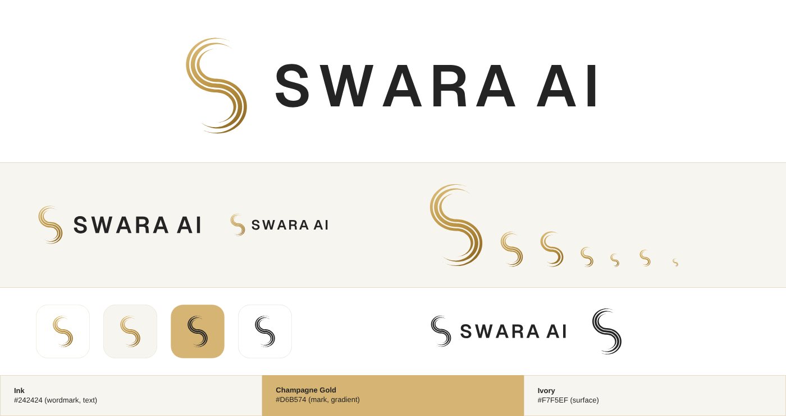

# SWARA AI brand kit

**SWARA AI**: *Every Voice. Smarter Commerce.*

SWARA AI is an intelligent, multilingual, voice-powered commerce platform designed to simplify grocery
ordering and digital operations for Indian Kirana stores.

- Short description: *Your intelligent voice-powered assistant for smarter grocery commerce.*
- Full description: *SWARA AI empowers Indian Kirana stores with multilingual voice ordering, intelligent
  product recognition, real-time inventory management, automated order processing, and actionable
  business insights.*

The same strings live in code, so the app, the API docs and the README cannot drift apart:
`frontend/src/lib/brand.ts` and `backend/app/brand.py` (`backend/tests/test_branding.py` checks both against
the wording above).

## The name

The only name in the logo is **SWARA AI**: two words, written exactly like that, in capitals. It is one
weight, one size and one colour, so it reads as one name. Do not write the product as SWARA alone, do not
add words or letters to the logo (no "Technologies", no taglines inside it), and never use the product's
former name.

## The mark

An **S made of three flowing gold ribbons**. The centre line is two stacked ellipse arcs joined with a common
tangent, so the S is smooth. Each ribbon follows a true parallel offset of that line, tapers to a point at both
ends, and has its own length, which reads as a voice waveform bent into a letter. Below about 40 px three fine
ribbons blur, so a **compact** two-ribbon S is used for the sidebar and the tab icon.

The wordmark is **SWARA AI** in Geist SemiBold capitals, converted to outlines so no SVG needs the font.
Geist is SIL OFL 1.1, which allows this.

## Colour

| Name | Hex | Use |
| --- | --- | --- |
| Ink | `#242424` | The wordmark and the text colour of the app |
| Champagne Gold | `#D6B574` | The mark, as a gradient: `#DDBF7C`, `#BC9444`, `#88621F` on ivory and white |
| Ivory | `#F7F5EF` | Page and card backgrounds, the share card, the ivory icon |

SWARA AI is **light only**. No icon tile, card, sidebar or share image it ships is black or dark: the app icons
are white, ivory or gold tiles, and the kit contains no reversed logo for dark backgrounds. Champagne gold on its own
is too pale to carry a shape on ivory (1.8:1), so the mark runs down to a deeper antique gold; the name itself
is Ink (measured in `docs/DESIGN.md`). Gold is a fill colour only: on a light page, gold *text* uses `#7a5810`.

## Files

Everything is generated from one geometry definition by `scripts/brand/build_logo.py`; do not edit the SVGs by
hand. Regenerate with `python scripts/brand/build_logo.py` (needs `fonttools`, `brotli`, `pillow`, `playwright`;
the Geist font file comes from `frontend/node_modules`). `scripts/brand/render_preview.py` redraws `preview.png`.

| File (in `svg/`; the `png/` folder has transparent PNGs at several sizes) | Use |
| --- | --- |
| `swara-logo-horizontal-light.svg` | Mark + wordmark for ivory and white backgrounds (the default) |
| `swara-logo-horizontal-mono.svg` | One-colour use in Ink: print, stamps, single-ink output |
| `swara-symbol-{light,mono}.svg` | The standalone S |
| `swara-symbol-compact-*.svg` | The two-ribbon S for small sizes |
| `swara-app-icon.svg` | Square app icon: gold S on white |
| `swara-app-icon-ivory.svg`, `swara-app-icon-gold.svg`, `swara-app-icon-mono.svg` | Gold S on ivory; Ink S on a champagne-gold tile; one-colour |
| `swara-favicon.svg` and `favicon.ico` | Browser tab: the compact S on a transparent background (`.ico` holds 16, 32 and 48 px) |
| `swara-social-card.svg` and `png/swara-social-card@1200x630.png` | Link-preview image on ivory (the only SVG with live `<text>`, for the tagline) |

The web app uses copies of the favicon, `apple-touch-icon.png`, `icon-192/512.png`, the social card and
`site.webmanifest` in `frontend/public/`, and the React components `Logo` and `LogoMark`
(`frontend/src/components/Logo.tsx`), which take their colours from the design tokens (`--text` for the wordmark).

## Using the logo

- **Clear space:** keep at least one quarter of the symbol's height free on every side (a design guideline, not
  something the app enforces).
- **Size:** the horizontal logo was checked on screen from about 175 px wide (the sidebar) up. Below that, or in a 24 to 40 px
  square, use the compact symbol alone. The favicon was checked at 16 px.
- **Backgrounds:** use the *light* logo on ivory or white. On anything else (a coloured panel, a photo) use the
  one-colour Ink version. Do not place the logo on a dark surface.
- **Don't** recolour the gold, stretch or skew the mark, add outlines, shadows or glows, rotate it, set the name in
  another typeface, split it into a large and a small word, or place the gradient mark on a mid-tone background
  where the gold loses contrast.
- **Don't** replace the S with an emoji, a generic microphone or a speaker icon.

## Not done

This is an original mark made for this project. No trademark or design-registration search has been run for the
name or the logo, and the logo has not been tested in print, on an operating-system icon grid, or at very small
physical sizes. Do that before any commercial use.
