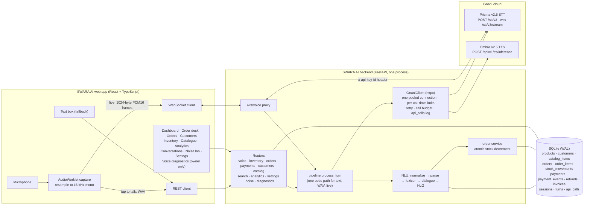
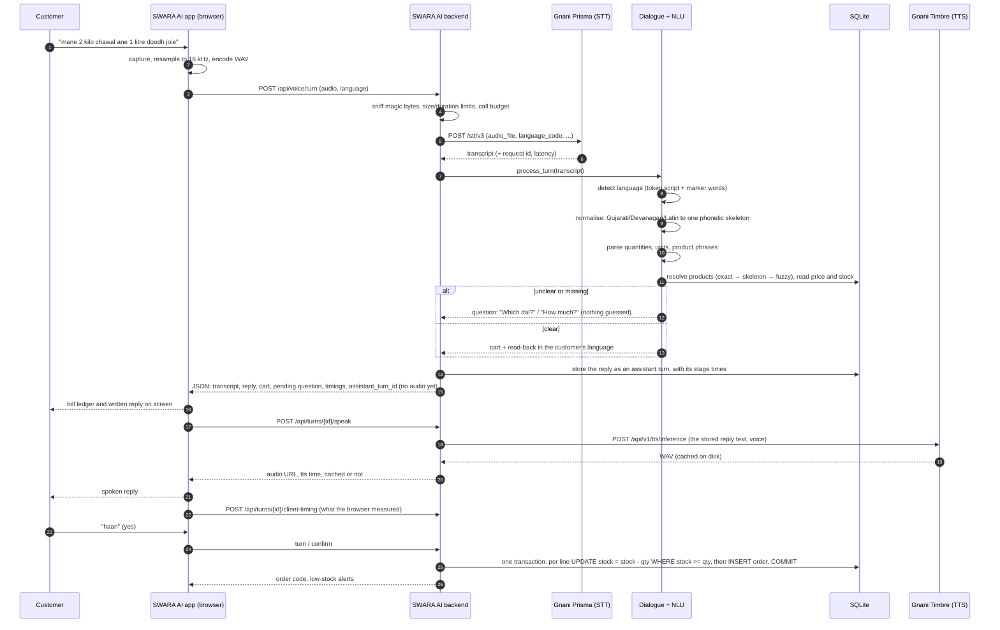
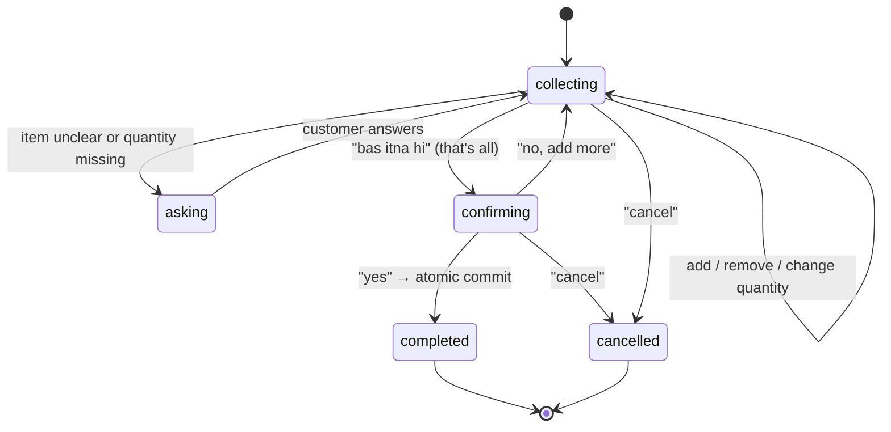
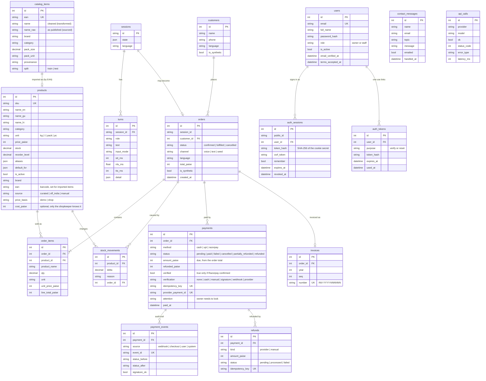
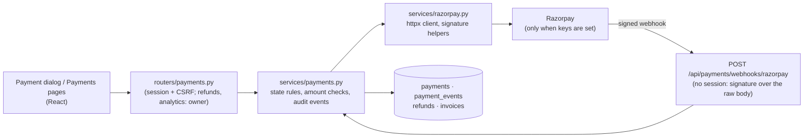

# Architecture

SWARA AI is a single FastAPI process (API + WebSocket proxy + static frontend) in front of a SQLite file. Gnani is the only external service the voice path uses; from 2.7.0 the payment module can also call Razorpay, and only when the owner has set Razorpay keys. The browser never talks to Gnani and never sees the key.

## 1. System diagram

## 2. AI workflow for one spoken turn

The same `pipeline.process_turn` serves typed text, uploaded or recorded WAV, and the live WebSocket, so all three behave identically and are tested through one code path.

Since 2.6.0 the reply and the bill are shown **before** the voice is made (the spoken reply is a second request, as drawn). This does not make speech recognition or synthesis
faster and it is not streaming: Gnani's REST endpoints return finished results, and the voice cannot be made before the reply text exists. It stops the screen waiting for a step
it does not need, and it means a failed or slow voice costs the person nothing but the voice.

## 2b. The voice path in 2.6.0: time limits, stage timing, diagnostics

**Gnani client** (`backend/app/gnani/client.py`). One pooled `httpx.AsyncClient` per server process, tied to the running event loop and replaced if the loop, base URL or transport
changes; closed on shutdown. Each call has its own time limit (speech to text 20 s, text to speech 15 s, connect 5 s; `GNANI_TIMEOUT_S` is a ceiling). A call that was sent and
got no answer in time ends as `TIMEOUT` and is **not** repeated; failures before the request was accepted, and `429`/`5xx`, are tried up to three times with short waits. Every call
writes an `api_calls` row including the number of attempts.

**Stage timing.** Each assistant turn stores `detail.timing` (JSON): `validate_ms` (audio checks), `stt_ms`, `nlu_ms`, `db_ms`, `process_ms`, `tts_ms`, `tts_cached`, `stt_attempts`,
`server_ms` and `mode` (`voice`, `stream` or `text`). The spoken reply adds its own time when it is made (`attach_audio`, which adds it once even if asked twice). What the browser
measured arrives separately and is stored under `detail.client` (`capture_ms`, `end_to_reply_ms`, `end_to_audio_ms`, `upload_bytes`, `endpoint`), so a figure measured by the browser is
never mistaken for one measured by the server. JSON columns are replaced as a whole when changed (SQLAlchemy does not notice edits inside a JSON value).

**Owner diagnostics** (`GET /api/diagnostics/voice?hours=1..720`, owner only; `backend/app/services/diagnostics.py`). Everything is read from rows the app already wrote: the
turns' stage times, the browser-reported times and the `api_calls` rows. Percentiles use linear interpolation (the numpy default). A figure with nothing behind it is `null` and the page
says "Not measured yet"; turns written before 2.6.0 have no timing and are left out rather than counted as zero. The route never returns the key and reports the time limits in force.

**Order processing stays on the event loop, on purpose.** `process_turn` takes about 7 to 11 ms. It is not moved to a thread pool because the guarantee that pressing Confirm twice makes one
order (a guarded `UPDATE ... WHERE stock >= qty` plus a status check) relies on the confirm path running one request at a time in the single server process. The network calls to Gnani
are the part that is awaited, so the loop is free while they are in flight. That guarantee is a limit, not a lock (run one server process); it is explained in [SECURITY.md](SECURITY.md).

**Browser** (`frontend/src/lib/audio.ts`, `pages/OrderDesk.tsx`). The recorder cuts silence from both ends before upload and, when "Send when I stop talking" is on, ends the recording
after a short silence that follows speech. The Order desk shows one state at a time (Listening, Understanding, Preparing the voice, Replying), keeps a recording that could not be
sent for **Try again**, notices when the device is offline before sending, and remembers the open bill's id in `sessionStorage` (per tab, six hours at most) so a reload or a visit to
another page puts the bill back from the server's snapshot (`GET /api/sessions/{id}`, which now includes the customer).

## 3. Why the decision layer is deterministic

Prisma and Timbre are speech models. The part that touches money and stock is plain code that can be read, unit-tested and replayed:

- **No hallucinated stock or prices.** Prices and stock come from the database inside the same transaction that saves the order.
- **Ambiguity is a question, not a guess.** "dal" matches several products, so the assistant asks *which one*. "tel" uses an explicit shop default and marks the line `default` on the bill.
- **Evon v3.3 is not used.** Gnani does not expose it on its public API (see [EVON.md](EVON.md)). Nothing in this repository claims Evon output.

## 3b. The language registry

`backend/app/languages.py` is the one table that says which languages exist and how each maps to Gnani: key, names, script, Prisma `language_code`, Timbre `language`, default voice, the documented Timbre v2.5 voices, and a sample sentence. The voice routes (`gnani/voices.py`), the realtime proxy, `GET /api/languages`, Settings, the verification script and the frontend language list all read it, so adding or switching off a language is one entry (plus one NLU pack) and not a hunt through the code. It raises `LanguageError` (`BAD_LANGUAGE`, `LANGUAGE_DISABLED`, `AUTO_DETECT_NEEDS_V3`) rather than substituting another language. What is known about live behaviour is **not** in this table: `services/verification.py` reads `eval/results/live_verification.json`, which only `scripts/verify_gnani.py` writes. See [LANGUAGES.md](LANGUAGES.md).

## 4. NLU pipeline

| Stage | File | What it does |
|---|---|---|
| Language detection | `nlu/parser.py: detect_language` | Counts script per *token* (not per character): each Indic script identifies its language (Devanagari is Hindi or Marathi, settled by marker words and, on a tie, by the language the person chose); Latin text is Hinglish, English or romanised Gujarati by marker words. Returns one of the 11 language keys, with a confidence flag. The chosen language is a hint, never a limit |
| Normalisation | `nlu/normalize.py`, `nlu/translit.py` | Unicode NFKC, Latin diacritics removed, the other Indic scripts (Gujarati, Bengali, Gurmukhi, Tamil, Telugu, Kannada, Malayalam) shifted onto Devanagari, Devanagari mapped to a roman phonetic **skeleton**: *doodh, દૂધ, दूध, dudh* → one key |
| Number grammar | `nlu/parser.py`, `nlu/vocab.py`, `nlu/langpacks/*.py` | digits, number, unit, filler and correction words per language (the original four in `vocab.py`, one pack per added language in `langpacks/`), *dedh, dhai, sava, saade, paune, aadha, half, quarter, dozen*, bare *sau* = 100, "half a kilo" |
| Units | `nlu/units.py` | kg, g, l, ml, pack, piece, dozen; pack conversion (tea 250 g packs); `Decimal` throughout |
| Product matching | `nlu/lexicon.py` | exact alias → skeleton match → case endings stripped (Marathi, Bengali, Dravidian and Punjabi suffixes) → `rapidfuzz` fuzzy match with a threshold; returns candidates, never silently the best of several |
| Dialogue | `nlu/dialogue.py` | state machine over a cart and a queue of pending questions |
| Replies | `nlu/nlg.py` | templates for all 11 languages, unit and number localised; product names in the bill language where the product has one |

### Dialogue state machine

In the API, *asking* is not a separate phase: it is `collecting` with a non-null `pending` question. Rendered images of every diagram on this page are in [`docs/diagrams/`](diagrams).

Pending question kinds: `choose_product`, `need_qty`, `need_unit`, `need_pack_count`, `need_whole`, `confirm_partial` (only part of the stock is available), `confirm_suggestion`, `confirm_unit`, `unit_wrong`. The UI offers yes/no chips only where yes/no is a valid answer; amount questions show a hint instead.

## 5. Data model

Money is stored as **integer paise**; quantities and stock are `Decimal`. Line totals use half-up rounding. All timestamps are UTC in the database and shown in IST in the UI; analytics bucket by IST day, week and month.

**Two kinds of provenance live in the schema.** `products.source` and `products.price_basis` say where a product record and its price came from; `orders.is_synthetic` and `customers.is_synthetic` mark generated demo rows. `catalog_items` is read-only reference data (no prices, no stock) loaded once from `data/processed/catalog_off_india.csv` when the database is first seeded; importing an item copies it into `products` with a price the shopkeeper supplies. A small `upgrade_schema()` adds the columns above to an older SQLite file so existing data survives (SQLite only; see [LIMITATIONS.md](LIMITATIONS.md)).

### Accounts and how a request is judged

Every request passes the same layers, in this order: **SecurityHeaders** (adds the response headers) → **OriginGuard** (refuses a state-changing browser request
from another site) → CORS → the route. Routes in the open group (`health`, `auth`, `contact`, the landing-page parser) guard themselves; every other router is
mounted with a dependency, `require_user`, which looks up the `swara_session` cookie, checks the server-side row (not revoked, not past its absolute or idle
expiry), and for any non-`GET` method compares the `X-CSRF-Token` header with the session's token. Owner-only routes add `require_owner`. The WebSocket does the
same cookie lookup during its handshake. The tables above hold only hashes of secrets: a copy of the database cannot be replayed as a cookie or a reset link.
Details and settings: [AUTHENTICATION.md](AUTHENTICATION.md); review and known risks: [SECURITY.md](SECURITY.md); running it for real: [DEPLOYMENT.md](DEPLOYMENT.md).

## 5b. Payments, refunds and invoices (2.7.0)

The module sits beside the order flow and never inside it. Money is integer paise; a payment is created **from an order the server already holds**, so the amount is read from the database, not from the browser. Stock is changed only by the order service, as before: no payment, refund or cancelled payment touches inventory.

- **States.** `pending`, `paid`, `failed`, `cancelled`, `partially_refunded`, `refunded`. A payment moves to `paid` only in `services/payments.py`, and only by one of four routes: cash recorded by a signed-in person, a UPI payment confirmed by hand, a Checkout reply whose signature checks out **and** whose payment Razorpay confirms on a lookup, or a signed webhook. Each route writes a `payment_events` row, and `payments.verification` says which one it was (`cash`, `manual`, `signature`, `webhook`, `provider`).
- **Unverified UPI.** The QR for the shop's own UPI ID is drawn in the browser from a UPI payment link. The server cannot see that money, so the payment is stored with `verified = false` and `verification = "manual"` and is labelled "Not verified" everywhere until a person confirms it; even then it is "confirmed by hand".
- **Checks before `paid`.** Amount, currency and Razorpay order id must equal what the server stored; a mismatch leaves the payment unpaid and raises an `attention` flag for the owner. A payment that arrives for an order that was cancelled, or a second collection for an order already paid, is kept and flagged, not silently merged.
- **Duplicates.** The database enforces one `pending` payment per order (a partial unique index), unique idempotency keys, unique Razorpay ids, and one processed webhook event id. A repeated request or webhook returns the stored result.
- **Refunds** are owner only. A Razorpay refund is `pending` until Razorpay says it was processed; the app never reports it as done earlier. Refunded money is capped at the amount paid, in the database as well as in code.
- **Invoices** are created on first request, numbered `INV-YYYY-NNNNNN` from a per-year counter, and print from the browser. They are receipts: no tax is configured or calculated (see [LIMITATIONS.md](LIMITATIONS.md)).
- **Secrets** are read from the environment only (`backend/app/config.py`), never stored in the database, returned by an endpoint, logged or sent to the browser. The Razorpay key **id** is sent to the browser only when Checkout needs it.

Reference: [PAYMENTS_API.md](PAYMENTS_API.md), [RAZORPAY_SETUP.md](RAZORPAY_SETUP.md), [PAYMENT_SECURITY_AUDIT.md](PAYMENT_SECURITY_AUDIT.md).

## 6. Correctness and safety decisions

| Concern | Decision | Test |
|---|---|---|
| Overselling | `UPDATE products SET stock = stock - :q WHERE id = :id AND stock >= :q`; if any line fails the already-applied lines are compensated and the order is rejected | `test_dialogue_api.py::test_stock_changed_between_cart_and_confirm_never_oversells` |
| Double cancel | Cancel restocks once; repeating it is idempotent (200, no second restock) | `test_api_admin.py::test_cancel_confirmed_order_restocks_exactly_once` |
| Float money | none: paise ints and `Decimal` | `test_units.py::test_line_total_is_exact_integer_paise_half_up`, `test_no_float_drift_on_many_small_quantities` |
| Secret handling | key lives in `.env`, read server-side; settings API returns only a mask; `.env` writes are validated | `test_security.py::test_api_key_never_appears_in_any_get_endpoint` |
| Logs | the web server's access log writes one-time reset and verification links as `token=[redacted]`; the app's own code does not log passwords, cookies or the Gnani key (checked by reading the code; only the token case has an automated test) | `test_security.py::test_one_time_links_are_redacted_in_the_access_log` |
| Abuse | per-IP rate limiter, upload size and duration caps, magic-byte audio sniffing (so a renamed file is rejected), session and origin check on the WebSocket, content-security policy and other response headers | `test_security.py` (rate limit, CORS, WebSocket origin), `test_api_voice.py` (WebM rejected) |
| Runaway cost | local Gnani call budget per hour (default 300) refuses calls before they leave the machine | `test_gnani_contract.py::test_local_budget_blocks_before_any_http_call` |
| Who may do what | accounts with an owner and a staff role; every route needs a session except a short public list; owner-only routes (inventory writes, order status, customer writes, catalogue import, settings, team, contact inbox) check the role on the server; per-session CSRF token; origin check | `test_security.py::test_route_inventory_every_api_route_is_guarded_or_deliberately_public`, `test_owner_routes_refuse_staff_and_visitors`, `test_writes_without_the_csrf_header_are_refused` |
| Sign-in abuse | scrypt password hashes, per-address and per-IP lock-out, per-IP rate limit on the sign-in family, one message for wrong password and unknown address, single-use hashed reset tokens | `test_auth.py` |
| Failure of Gnani | every Gnani error is mapped to a message a shopkeeper can act on; typed ordering keeps working | `test_gnani_contract.py`, `test_api_voice.py` |

## 7. Frontend structure

| Area | Files |
|---|---|
| Shell and routing | `App.tsx` (public routes, then `RequireAuth` around the app routes), `components/Shell.tsx` (sidebar with the person's name and role and a sign-out button, top bar, theme, Demo data switch), `CommandPalette.tsx` (Ctrl/⌘ K), `ErrorBoundary.tsx` |
| Design system | `styles/tokens.css` (the one light theme), `styles/ui.css` (buttons, fields, tables, badges, drawers), `styles/app.css` (layout and page styles); see [DESIGN.md](DESIGN.md) |
| Shared components | `components/ui.tsx` (Button, Field, Badge, Card, Seg, Empty, Skeleton...), `Overlay.tsx` (Dialog and Drawer with focus trap and restore), `Kpi.tsx`, `charts.tsx` (trend, bars, columns, legend, Chart/Table switch), `Toast.tsx`, `Combobox.tsx`, `CustomerForm.tsx`, `QuickReplies.tsx`, `desk/` (the bill and the product and customer pickers) |
| Accounts | `lib/auth.tsx` (`AuthProvider`: asks `/api/auth/session` on start, holds the user and CSRF token in memory only, signs out on any `401`; `RequireAuth`; `safeNext`), `lib/password.ts` (the strength guide; the server decides), `components/AuthKit.tsx` (auth page frame, fields, show/hide, meter), `pages/auth/` (sign-in, sign-up, forgot, reset, verify), `pages/Account.tsx` |
| State and data | `api/client.ts` (typed requests, uniform error mapping, de-duplicated GETs with a short cache that writes clear), `lib/hooks.ts` (`useAsync` with optional polling that pauses in a hidden tab, `useUrlState`, `useDebounced`, `useHotkey`), `lib/scope.tsx` (the Demo data switch), `lib/theme.tsx`, `lib/stats.ts` (comparison rules), `lib/format.ts` |
| Audio | `lib/audio.ts`: AudioWorklet capture with ScriptProcessor fallback, streaming linear resampler to 16 kHz, WAV encoder, PCM16 framing |
| Payments | `components/payments/` (`PaymentDialog`: choose a way, take cash, show the QR, open Razorpay Checkout; `UpiQr`: the QR drawn as one SVG path with the MIT-licensed `qrcode-generator`; `badges`, `PayCharts`, `PaymentsSettingsCard` for the UPI ID in Settings), `pages/Payments.tsx` (history, filters), `pages/PaymentDetail.tsx` (timeline, owner refunds), `pages/PaymentAnalytics.tsx` (owner), `pages/Invoice.tsx` (printable), `lib/payments.ts` (rupee and paise rules mirrored from the server, so the form and the server agree) |
| Pages | Landing (`pages/Landing.tsx` and `pages/landing/`: nav, the five-area product showcase, the language showcase, the live parser demo with its four-step strip, contact form, content), Terms, Privacy, Not found, Dashboard, OrderDesk, Orders, Customers, Inventory, Catalogue, Analytics, Live (Conversations), NoiseLab, Settings, Account. Heavy pages are lazy-loaded |

Table and drawer state (search, filters, sort, page, the open record) lives in the URL, so a view can be bookmarked or shared and the back button works. Every chart has a Table view, and any figure that depends on generated data follows the global Demo data switch.

The interface is called "Counter" in the design notes: a quiet neutral shell, a receipt-style bill as the one piece of character, champagne gold used only for the brand mark, the voice orb, the accent button and the active-page marker, on white pages and cards with an ivory sidebar, with the Ink wordmark (SWARA AI palette, see [DESIGN.md](DESIGN.md)). There is no dark theme. Charts use a categorical palette validated against the white chart surface.
