{ width=45% }&nbsp;

*This report is generated by `scripts/build_report.py` from the saved result files in `eval/results/` and `docs/report-data/`. Every number in the text, tables and figures is read from those files when the report is built, so a number cannot drift from the evidence. The evaluation file was built on 2026-11-11.*

# 1. Executive summary

**SWARA AI is an intelligent, multilingual, voice-powered commerce platform designed to simplify grocery ordering and digital operations for Indian kirana stores.** A customer says an order in their own language. The assistant listens with Gnani Prisma, works out the items, quantities and units, checks live stock, adds up the bill, reads it back in the customer's language with Gnani Timbre, and saves the order only after the customer says yes. Around that sits a back-office for the shopkeeper: a dashboard, orders, customers, inventory with a stock ledger, a catalogue of 5,325 real packaged products from public data, payments (cash, a UPI QR code and Razorpay Checkout in test mode) with refunds, numbered invoices and payment analytics, analytics computed from the same database, and an AI Performance page that shows how well the language engine does and where it does not.

The language engine understands eleven languages: the ten Indian languages Gnani documents for its speech models (Hindi, Indian English, Gujarati, Marathi, Bengali, Tamil, Telugu, Kannada, Malayalam, Punjabi) and Hinglish. The software is a React and TypeScript web app, a FastAPI backend and a SQLite database, and starts on Windows with one command and no Docker.

**What the evidence says (the language results are on text only; nothing comes from a live Gnani or Razorpay call).**

- On 300 held-out branded-product sentences the parser returned exactly the right product for 244 (81.3%), asked which pack was meant for 16 (5.3%), did not recognise 21 (7.0%) and returned a wrong product for 19 (6.3%). The wrong product is the costly outcome, so it is the figure to watch.
- Typed orders taken through the real dialogue to a saved order: 340 of 340 scored sentences produced the right order. In the stock-guard check, 84 of 84 orders for items that were out of stock were refused, and no check produced negative stock.
- Against simulated typing damage the whole-order match falls from 100% with no damage to 78.6% at 3%, 63.3% at 6%, 46.0% at 10% and 32.5% at 15% of characters.
- Payments (release 2.7.0): 158 of 158 payment tests passed, run against a stand-in for Razorpay. In the scripted demo session of Section 11, 4 payments went through the app's own routes: cancelling an order that still held collected money was refused (HTTP 409, `PAID_ORDER`), an invoice kept its number when asked for twice, and no payment step changed the stock of any of 69 products.

**What is not known.** No call to Gnani has been made from this project's build environment, because it had no key and no route to Gnani's servers. Speech recognition accuracy, word error rate, speech latency and acoustic-noise behaviour are therefore **not measured**, and none of the eleven languages is marked as verified live. **No call to Razorpay has been made either**: its client was tested only against a stand-in that the author wrote from Razorpay's public documentation as remembered while building, no payment went through Razorpay in test or live mode, and no Razorpay key was used. A UPI QR code points at the shop's own UPI ID and the app cannot see whether money arrived, so a person confirms it and it stays labelled unverified. The seven languages added after the first four were written without review by native speakers. The product catalogue contains no prices; prices, orders and customers shown in the demo are generated and are labelled as such. Section 20 lists every limitation, and Section 19 separates what was run for this report from what is mocked, live or not run.

# 2. Problem statement

India has millions of kirana stores. Orders arrive by phone call, WhatsApp voice note or at the counter, in the language the customer thinks in: Gujarati in Vadodara, Hindi in Delhi, and often a mix, such as "mane 2 kilo chawal ane ek packet bread joie". A shopkeeper serving a queue writes these on paper, so stock is guessed, bills are added by hand, and demand data is never captured.

Typing is slow, and many customers and shopkeepers are more comfortable speaking. General voice assistants handle Hindi and English but stumble on Gujarati, on sentences that mix languages, and on the vocabulary of a shop (*dedh kilo*, *sava*, *ek packet*, *tel*). They also do not know what is in stock, so they can promise something that is not on the shelf.

Three requirements follow. The system must understand mixed, code-switched speech in several Indian languages. It must never invent a product, a price or a quantity, because a wrong bill costs the shopkeeper money and the customer's trust. And it must be honest about what it has and has not been tested on, because a voice product that is only demonstrated on clean sentences hides the cases that matter.

# 3. Proposed solution

SWARA AI puts a deterministic decision layer between two speech models. Prisma turns speech into text and Timbre turns text into speech, but everything that touches money and stock is ordinary, testable code. The assistant cannot make up a product, because it can only return products that exist in the shop's catalogue, and when it is unsure it asks.

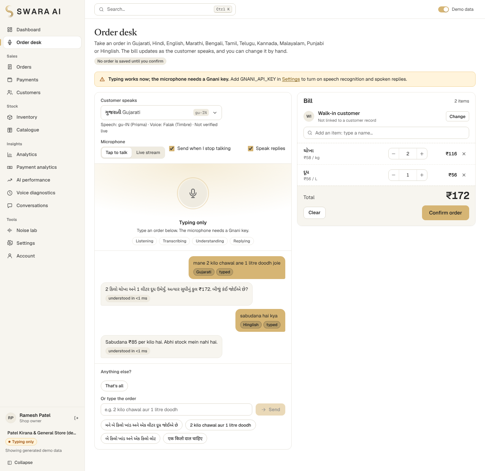

A turn goes through one path regardless of how the words arrive (typing, a recorded clip, or a live stream): listen, understand, check, reply, commit. Section 7 follows one order through each step. The shopkeeper works in a light, uncluttered interface with these screens:

| Screen | What it does |
|---|---|
| Dashboard | Today so far, the last 7 days, sales trend, best sellers, restock list, recent orders; a new owner also sees a four-step setup checklist whose ticks come from the shop's own data |
| Order desk | Speak, stream or type an order; editable bill; customer picker; confirm |
| Orders, Customers | Search, filters, status counts, details drawer with the order's payment status; CSV export of orders and customers; print a bill |
| Payments | History with filters; a payment's detail with its refunds and audit trail; take payment for an order by cash, UPI QR code or Razorpay Checkout in test mode |
| Inventory | Server-side search, filter, sort and pagination; restock and edit; stock-movement table; CSV export |
| Catalogue | 5,325 public products with a provenance drawer; adding one to the shop requires the shopkeeper's own price |
| Analytics | Sales by day, week or month; order mix by status, language, channel and hour; demand and days of cover; stock valuation and stock movement; every chart has a table view |
| Payment analytics (owner only) | Money collected by day, week or month and by way paid, refunds, payments still waiting; every chart has a table view |
| Invoice | A numbered, printable receipt for an order; it is not a GST tax invoice |
| AI Performance | The evaluation results of the language engine: metrics, per-language results, confusion matrices, robustness curve, test record and response times |
| Live, Noise lab, Settings | Speech call log with latency, noisy-text experiments, Gnani configuration (key shown only as a mask), the shop's UPI ID and the state of Razorpay (secrets are never shown) |

# 4. Objectives

1. **Understand how people really order.** Accept eleven languages, number idioms (*dedh*, *dhai*, *sava*, "half a kilo"), units, and sentences that mix languages and scripts.
2. **Be correct before being clever.** Match each phrase to a catalogue product or ask; never add a product the shop does not sell; never sell stock that is not there.
3. **Be useful to the shopkeeper.** Orders, stock, demand and valuation in one place, computed from the same database that takes the orders.
4. **Be honest about evidence.** Every claim is either measured by a script whose output is saved, or labelled as not measured. Demo data is labelled. A result that could not be produced is shown as "Not measured", never estimated.
5. **Keep keys safe.** The Gnani key lives only on the server, is masked in the interface, and is never written to logs or documents.
6. **Run on an ordinary Windows laptop.** One setup command, one start command, no Docker.
7. **Handle money without guessing.** A payment is created for an order the server holds, never for an amount the browser sends; it is marked paid only by a person who saw the money or by Razorpay's own confirmation; a UPI payment that no provider confirmed is labelled that way; and no payment step changes stock.

# 5. System architecture

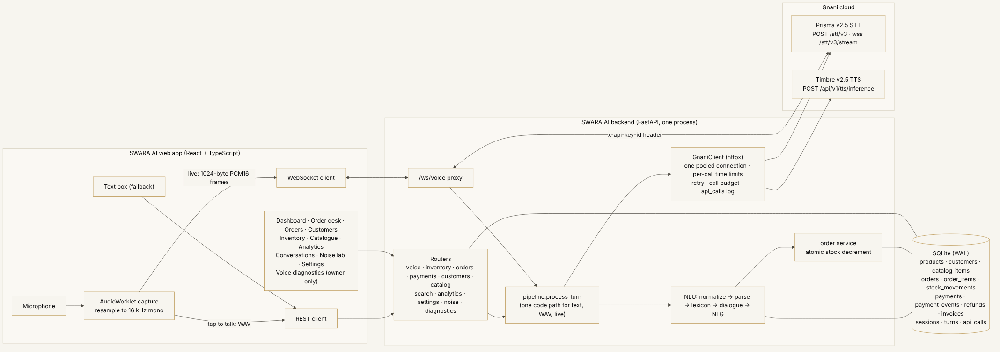

The browser talks to one FastAPI process, which also serves the built web app. The process owns the database, the language engine, the Gnani client and the payment module, which calls Razorpay only when the owner has set Razorpay keys. The browser never sees the Gnani key or a Razorpay secret and never calls Gnani directly.

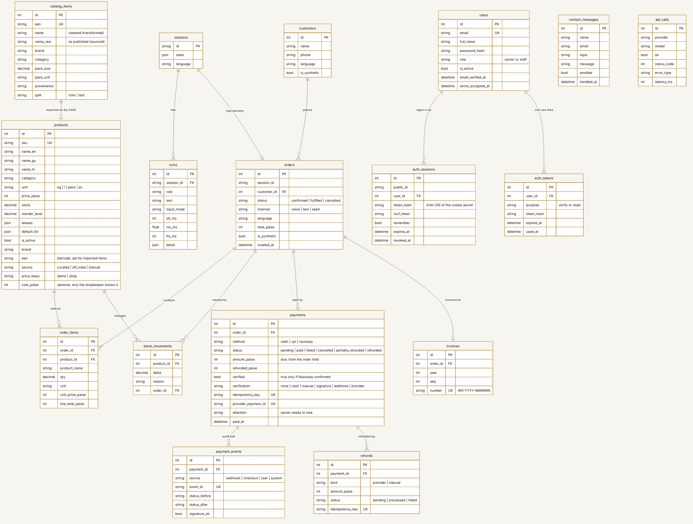

The four payment tables (`payments`, `payment_events`, `refunds` and `invoices`) are new in 2.7.0. They are added to an existing database by one additive migration that first writes a backup copy of the file and leaves every existing row as it was.

Key decisions:

- **A deterministic decision layer.** Prisma and Timbre are speech models. Product matching, quantities, prices, stock and the bill are plain code that tests can pin down.
- **One pipeline for all channels.** Typed text, a recorded clip and a live stream share `pipeline.process_turn`, so they behave identically and are tested once.
- **Money as integers.** Prices, totals, payments and refunds are stored in paise as integers and quantities as `Decimal`; there is no floating-point money.
- **Payments beside orders, not inside them.** A payment belongs to an order the server already holds, and only the order service changes stock. Section 11 describes the module.
- **A stock ledger.** Every change to stock (an order, a cancellation that returns stock, a restock, a manual adjustment) writes a row to `stock_movements` in the same database commit as the change itself, so the Inventory and Analytics screens can show where stock went.
- **Speech failure never blocks ordering.** If Prisma or Timbre fails, the error is explained in plain words and typing keeps working.

# 6. Technology stack

The stack table is read from the evaluation file, which records the installed version of each component when it was built.

**Table 1. Technology stack and implementation status.**

| Component | Technology | Purpose | Implementation status |
| --- | --- | --- | --- |
| API server | fastapi 0.162.2, uvicorn 0.54.0 | REST and WebSocket API; also serves the built web app | Implemented and tested |
| Database | SQLite through SQLAlchemy 2.1.8 | Products, customers, orders, stock ledger, conversations, accounts, payments, refunds and invoices | Implemented and tested |
| Validation and settings | pydantic 2.14.3, pydantic-settings 2.16.2 | Request validation and environment configuration | Implemented and tested |
| Accounts and sessions | scrypt password hashing (RFC 7914), server-side sessions in an HttpOnly cookie, CSRF token | Sign-in, owner and staff roles, protected routes | Implemented and tested |
| Product matching | Own exact, phonetic-skeleton, case-stem stages and rapidfuzz 3.14.6 | Find the product a spoken or typed line refers to, in 11 languages | Implemented; evaluated on text only |
| Audio handling | numpy 2.5.4 | Check and convert recorded audio before it is sent; the Noise lab | Implemented and tested |
| Outbound HTTP | httpx 0.28.1 | Calls to Gnani, and to Razorpay when the owner has set test keys, from the server; the Gnani key and the Razorpay secrets never reach the browser | Implemented and tested |
| Payments | Own payment module over SQLite: state rules, audit trail, refunds, invoices; cash, UPI link and QR, Razorpay Checkout (test mode) through httpx, no Razorpay SDK | Take payment for an order, refund it, print an invoice, report collected money | Implemented and tested; Razorpay was tested against a stand-in, never against the real service |
| UPI QR code | qrcode-generator 1.5.2 | Draws the QR for the shop's own UPI payment link in the browser; nothing is sent anywhere | Implemented and tested |
| Speech recognition | Gnani Prisma v2.5 | Turn the customer's speech into text | Implemented; tested with mocked HTTP, not live-verified |
| Speech synthesis | Gnani Timbre v2.5 | Read the bill and questions back in the customer's language | Implemented; tested with mocked HTTP, not live-verified |
| Evon | Not integrated | Mentioned in docs/EVON.md only | Not used |
| Product catalogue data | Open Food Facts India extract (ODbL), bundled as a file | 5,325 real packaged products: names, brands, pack sizes; no prices | Implemented and tested |
| Web app | React 18.3.1, TypeScript 5.9.3 | Order desk, inventory, orders, payments, analytics, AI performance, settings | Implemented and tested |
| Routing and build | React Router 7.18.5, Vite 7.3.8 | Pages and the production bundle | Implemented and tested |
| Charts | Recharts 3.10.1 plus plain SVG and HTML | Every chart has a table view; matrices are real HTML tables | Implemented and tested |
| Fonts | Newsreader, Geist, Geist Mono, Noto Sans Indic, self-hosted with @fontsource | Typography, with no request to a font service | Implemented and tested |
| Tests | pytest 9.2.0, Vitest 4.1.12, Playwright for Python with Chrome | Backend, component and browser tests | Implemented and tested |
| Windows start-up | setup.bat, start.bat, dev.bat, test.bat, verify_gnani.bat | One-command install and run without Docker | Implemented; scripts reviewed, not run on Windows in this environment |

*Source: eval/results/evaluation_summary.json, key technology.*

Evon, another Gnani model, is not used: it is not offered on Gnani's public API. It is mentioned in `docs/EVON.md` only. Razorpay is reached with the same `httpx` client library as Gnani, without a Razorpay SDK, and the UPI QR code is drawn in the browser by `qrcode-generator` (the one dependency added in 2.7.0).

# 7. Workflow

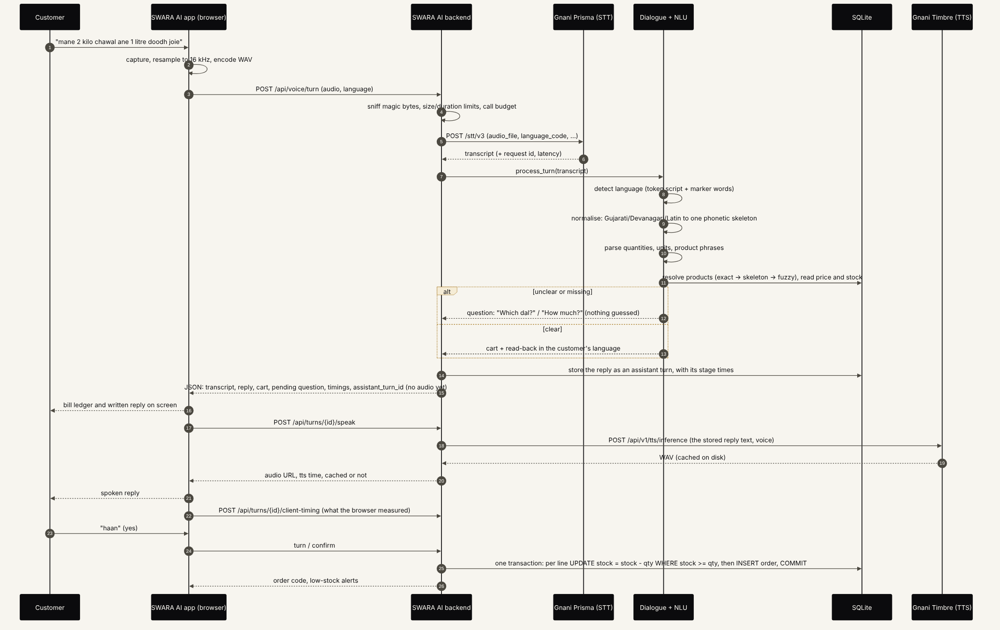

1. **Listen.** The browser captures 16 kHz mono audio and sends a WAV file, or 1024-byte PCM frames in live mode, to the backend. The backend forwards it to Prisma. If the customer types instead, this step is skipped.
2. **Understand.** The transcript is normalised so that *doodh*, *દૂધ* and *दूध* are one word. Quantities, units and product phrases are extracted and each phrase is matched to a product (Section 10).
3. **Check.** Prices and stock come from the database. If a product is ambiguous (*dal*), a quantity is missing, or only part of the stock is available, the assistant **asks** and does not guess.
4. **Reply.** The answer is composed in the customer's language, shown as a receipt-style bill, and spoken with Timbre if a key is configured.
5. **Commit.** After an explicit yes, one transaction decrements stock with a guarded `UPDATE ... WHERE stock >= qty` for each line, writes the stock-ledger rows and inserts the order. If stock changed in the meantime the order is refused instead of oversold. Cancelling an order returns its stock once. Paying for the order is a separate step that comes after this one (Section 11) and never touches stock.

Pressing confirm twice, or saying "yes" again after the order is saved, does not create a second order; this is covered by tests that also run two confirmations at the same moment.

# 8. Voice pipeline

| Model | Use | Endpoint | Status |
|---|---|---|---|
| Gnani Prisma v2.5 (default), v3.0 (option) | Speech to text, one documented language code per request (`hi-IN`, `en-IN`, `gu-IN`, `mr-IN`, `bn-IN`, `ta-IN`, `te-IN`, `kn-IN`, `ml-IN`, `pa-IN`) | `POST https://api.vachana.ai/stt/v3`, streaming over a WebSocket | Implemented from the public documentation; tested against a documentation-based simulator; **not verified live in any language** |
| Gnani Timbre v2.5 | Spoken replies, one of the documented voices per language (Hinglish uses the `hi-en` voice set) | `POST /api/v1/tts/inference` | Same |
| Evon | Reasoning | None | Not used |

The client sends the key in the `X-API-Key-ID` header, builds the request as documented, parses each documented error shape, retries only connection errors and HTTP 429, 500, 502, 503 and 504 with exponential back-off, and refuses calls locally after a configurable hourly budget so a bug cannot spend a free allowance. The documentation for Prisma v2.5, Timbre v2.5 and the language and voice lists was re-read on 11 November 2026, and the endpoints, header name and language codes in the code were checked against it. Timbre v2.0 is documented as deprecated and is not used.

Language is chosen per request from one registry (`backend/app/languages.py`). Prisma v2.5 documents no auto-detection, so the app does not offer it and refuses `auto` rather than guessing. An unknown or switched-off language is an error and never silently becomes a different language. There is no fallback provider. If no key is configured, voice features say so in words and typed ordering continues to work.

`verify_gnani.bat` runs four live checks per language when a key is present: Timbre synthesis, Prisma accepting the language code, Prisma transcribing Timbre's own speech, and, if a recording is supplied, Prisma transcribing a person. Only its saved output can turn a language to "Live checked" in the app. **It has not been run for this report.**

The browser-to-server streaming proxy re-chunks audio into the exact frame size Gnani documents and turns only final transcript messages into order turns. While a reply plays, the browser stops sending microphone frames so that the assistant does not hear itself.

# 9. Multilingual architecture

One word has many spellings in many scripts. The engine maps each Indic script (Gujarati, Bengali, Gurmukhi, Tamil, Telugu, Kannada, Malayalam) onto Devanagari by a fixed code-point offset, and then maps Devanagari to a roman phonetic skeleton, so that variants converge: the word for milk in Gujarati, Hindi, Bengali and Punjabi script, or typed in roman letters, reduces to one string. It reads number idioms (*dedh*, *dhai*, *sava*, *saade*, *paune*, a bare *sau* as 100, "half a kilo"), keeps genitive particles from splitting product names (*मूंग की दाल* is one product), detects language per word rather than per character so that code-mixed sentences are labelled correctly, and answers in the language the customer used.

Each language is a data pack in `backend/app/nlu/langpacks/` with its number words, units, product names for the 65 staples, corrections and reply templates, merged into the same parser. Case endings that Dravidian, Bengali, Marathi and Punjabi attach to a noun are stripped before matching. Hindi and Marathi share Devanagari, so marker words decide, then the language chosen in the selector.

**Where each language stands.** Gujarati, Hindi, English and Hinglish were the original four, and their sentences and expected results were written by the author of the parser, which makes their results a ceiling. The other seven (Marathi, Bengali, Tamil, Telugu, Kannada, Malayalam and Punjabi) have a few authored sentences each and **have not been reviewed by a native speaker**. **Table 2. Language evaluation (text only).**

| Language | Sentences (non-brand sets) | Exact order match | Held-out brands exact | Language label correct | Typed order correct |
| --- | ---: | ---: | ---: | ---: | ---: |
| Gujarati | 78 | 100.0% | 47 of 60 (78.3%) | 139 of 139 (100.0%) | 77 of 77 |
| Hindi | 71 | 100.0% | 50 of 60 (83.3%) | 132 of 132 (100.0%) | 70 of 70 |
| English (India) | 64 | 100.0% | 49 of 60 (81.7%) | 125 of 125 (100.0%) | 63 of 63 |
| Hinglish | 75 | 100.0% | 98 of 120 (81.7%) | 195 of 196 (99.5%) | 74 of 74 |
| Marathi | 7 | 100.0% | not in set | 5 of 7 (71.4%) | 7 of 7 |
| Bengali | 9 | 100.0% | not in set | 9 of 9 (100.0%) | 9 of 9 |
| Tamil | 8 | 100.0% | not in set | 8 of 8 (100.0%) | 8 of 8 |
| Telugu | 8 | 100.0% | not in set | 8 of 8 (100.0%) | 8 of 8 |
| Kannada | 8 | 100.0% | not in set | 8 of 8 (100.0%) | 8 of 8 |
| Malayalam | 8 | 100.0% | not in set | 8 of 8 (100.0%) | 8 of 8 |
| Punjabi | 8 | 100.0% | not in set | 8 of 8 (100.0%) | 8 of 8 |

*Source: evaluation_summary.json, keys sentence_check, language_detection and end_to_end.*

Table 2 lists, per language, how many sentences exist and how many of them the engine got exactly right in each check. The counts for the seven added languages are small (7 to 9 language-label checks and 8 or 9 typed orders each), so a percentage for any of them can move a lot with a single sentence. Marathi's language-label accuracy of 71.4% is a real effect, not noise in a large sample: Marathi and Hindi share a script and many words, and the app resolves them with the language selector.

# 10. Product matching methodology

Matching a phrase such as "Parle-G" or "tel" to a product is done in stages, each of which can only return a product that exists in the shop:

1. **Exact name or alias.** The normalised phrase equals a product name or a stored alias.
2. **Phonetic skeleton.** Vowel variation and script differences are removed, so *chawal*, *chaval* and *चावल* meet.
3. **Case-ending removal.** Endings such as the Marathi or Tamil case suffixes are stripped.
4. **Fuzzy match.** A string-similarity score (RapidFuzz, built on edit-distance ideas going back to Levenshtein) is accepted only above a threshold, and Latin-script brand words need a longer sound-alike match to land on a staple's name that exists only in another language.

The outcome of a line is one of the following, and each has a defined behaviour in the dialogue:

| Outcome | Meaning | What the assistant does |
|---|---|---|
| Exact product | One product, clearly | Adds it to the bill |
| Brand or pack match | A brand name with one pack size on the shelf | Adds that pack |
| Several plausible packs | Same brand or name, several pack sizes | Asks which pack, listing the options |
| Quantity missing | Product clear, amount not | Asks how much |
| Out of stock or part stock | Not enough on the shelf | Says so and offers what is left |
| Not recognised | Nothing close enough | Asks the customer to say it differently; adds nothing |
| Wrong product | The matcher returned a different product from the one meant | The failure being measured; the shopkeeper sees the bill and can edit it before saving |

The pack-size handling matters: a phrase like "Amul butter" can fit several packs of the same brand. For release 2.5.0 an alias defect was fixed in which a brand's pack-less alias belonged only to the pack imported first, so the sentence quietly became that pack whatever else the shop stocked. Packs of the same brand now share the alias, the parser sees several candidates, and the dialogue asks which pack. Shops that already existed keep the aliases they had; products imported on release 2.5.0 get the corrected ones.

Nothing in this chain asks a language model to guess. The cost is coverage: a phrase the grammar and the catalogue do not cover becomes a question.

# 11. Payments and billing

Release 2.7.0 adds payments to the existing order flow. A shopkeeper opens a confirmed order, chooses how the customer paid, and the app records it, can refund it, issues a numbered invoice and reports what was collected. The module sits beside the order flow and not inside it: the voice path, the parser, the Gnani client and the order and inventory services are unchanged from 2.6.0, and a payment, a refund or a cancelled payment never changes stock.

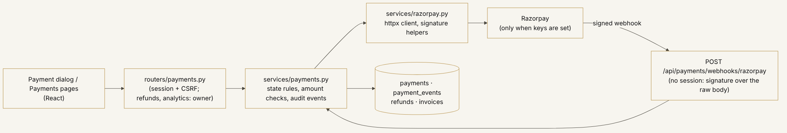

A payment is created from an order the server already holds, so the amount is read from the database and never from the browser; the browser sends only the way of paying. Money is an integer number of paise throughout.

**Three ways to pay, and what each one proves.**

| Way | What happens | What the app can and cannot claim |
|---|---|---|
| Cash | A person records the cash received, which must be at least the bill; the change is worked out and not stored as money. An obvious slip (more than 20 times the bill plus Rs 1,000) is refused | "Cash recorded by" the person's name. No provider is involved, so it is stored as not verified |
| UPI QR code | The browser draws a QR code for a UPI payment link to the shop's own UPI ID. A person who has seen the money confirms it and types the bank reference | Stored as `verified = false` with `verification = manual` and labelled "Not verified". The server cannot see UPI money |
| Razorpay Checkout (test mode) | The server creates a Razorpay order and the browser opens Checkout. The server accepts the payment only after a valid signature and a lookup at Razorpay that agree on amount, currency and order; a signed webhook can confirm it as well | Verified by Razorpay. **Never exercised against the real Razorpay service: tested against a stand-in only** |

Razorpay stays off until the owner puts test keys in `.env`. With `PAYMENT_MODE=live` the app additionally refuses anything but a live key, and no live key was used for this report.

**States.** A payment is waiting (`pending`), paid, failed, cancelled, partly refunded or refunded. At most one payment per order can be waiting, and the database enforces that. A failed payment can be paid again, and a waiting payment is closed automatically when its order is cancelled. For Razorpay, a refund moves a payment to partly refunded or refunded only once Razorpay says the refund was processed. An order with no payment in the app is shown as "Not recorded", which is not the same as unpaid: shops took cash before payments existed here, and those orders are left exactly as they were.

**Rules that keep money honest.**

- The amount, currency and Razorpay order id must equal what the server stored. A mismatch leaves the payment unpaid and flags it for the owner (`amount_mismatch`).
- A repeated request does nothing twice. Idempotency keys, one waiting payment per order, unique Razorpay payment ids and a unique webhook event id are database rules and not only checks in code.
- Checkout and webhook signatures are HMAC-SHA256 values compared in constant time. The webhook signature is checked over the exact bytes received before anything in the body is read, and without a webhook secret the webhook answers 503.
- Money that arrives in the wrong situation is kept and flagged, never merged silently: a late payment, a second collection for an order that is already paid, a payment for a cancelled order, a refund total above the amount paid.
- Refunds are for the owner only. A reason is required and the refunded total can never pass the amount paid, in code and in the database. A Razorpay refund stays "waiting" until Razorpay confirms it. A cash or UPI refund is recorded by the owner and labelled "Recorded by the owner. Not confirmed by a payment provider."
- An order that still holds collected money cannot be cancelled (HTTP 409, `PAID_ORDER`); it must be refunded first.
- Every change is a row in an audit trail with its source, the status before and after, and whether a signature was valid. Card numbers, UPI PINs and secrets are never stored or logged.

**Invoices.** The first request for an order's invoice creates it, with a number `INV-YYYY-NNNNNN` from a per-year counter. Every later request returns the same number. Table 3 is the invoice of one demo order. It is a receipt: no merchant tax details are configured, no tax is calculated, and the invoice says so. It is not a GST tax invoice, and the project makes no GST claim.

**Table 3. An invoice as the app issues it.**

| Item | Quantity | Unit price | Amount |
| --- | ---: | ---: | ---: |
| Rice | 2 kg | Rs 58.00 | Rs 116.00 |
| Milk | 1 l | Rs 56.00 | Rs 56.00 |
| Subtotal |  |  | Rs 172.00 |
| Discount |  |  | Rs 0.00 |
| Total |  |  | Rs 172.00 |
| Paid: Cash recorded by Ramesh Patel |  |  | Rs 172.00 |

*Source: docs/report-data/demo_activity.json, payments.invoice (a receipt for a demo order; it is not a GST tax invoice).*

**Payment analytics.** The owner's payment analytics are sums over the `payments` and `refunds` tables only. Orders with no payment record are not counted as money received, and waiting, failed and cancelled payments are not collected money.

**What the scripted session did.** To have genuine records to show, `scripts/demo_activity.py --payments` put 4 payments through the app's own routes on a fresh throw-away 2.7.0 database, after the typed orders described under Graphical analysis: cash on one order, a hand-confirmed UPI QR on another, cash on a third followed by a Rs 10 refund recorded by the owner, and a UPI QR shown on a fourth and left waiting. One order was left with no payment record on purpose, and one had been cancelled before any payment.

**Table 4. Payments recorded by the scripted demo session.**

| Payment | Order | Way | Status | How it was confirmed | Bill | Refunded |
| --- | --- | --- | --- | --- | ---: | ---: |
| PAY-261111-0001 | SW-261111-3066 | Cash | Paid | Cash recorded by Ramesh Patel | Rs 172.00 | - |
| PAY-261111-0002 | SW-261111-3068 | UPI QR (shop's own ID) | Paid | Confirmed by Ramesh Patel. Not verified by a payment provider | Rs 111.00 | - |
| PAY-261111-0003 | SW-261111-3069 | Cash | Partly refunded | Cash recorded by Ramesh Patel | Rs 148.00 | Rs 10.00 |
| PAY-261111-0004 | SW-261111-3070 | UPI QR (shop's own ID) | Waiting | Waiting for the customer to pay, not yet confirmed | Rs 121.00 | - |

*Source: docs/report-data/demo_activity.json, payments.history (the app's own payment list; one order was left without a payment record on purpose and one had been cancelled before any payment).*

By the end, Rs 431.00 had been collected (cash Rs 320.00, UPI Rs 111.00, Razorpay Rs 0.00), Rs 10.00 refunded, leaving Rs 421.00 net, with Rs 121.00 still waiting. Figure 1 and Table 5 are the owner's payment analytics for that session.

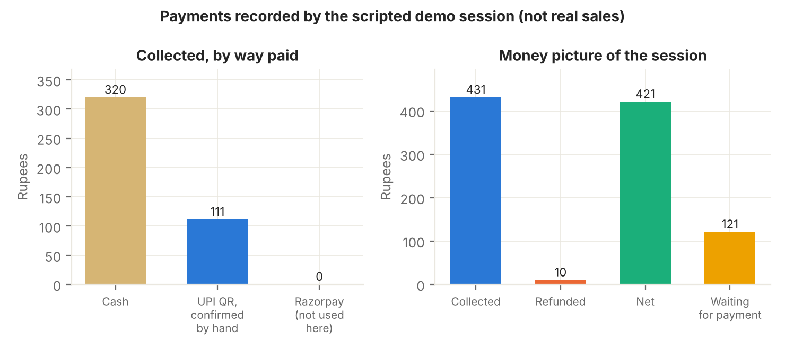{ width=100% }

*Figure 1. Payments of the scripted demo session.* Left: money collected by way paid, from the payment analytics. Right: collected, refunded, net and still waiting. Four payments and one part refund made through the app's own routes on a throw-away database; Razorpay was not used. *Source: docs/report-data/demo_activity.json, payments.analytics.*

**Table 5. Payment analytics of the scripted demo session.**

| Measure | Value | What it counts |
| --- | ---: | --- |
| Collected | Rs 431.00 | 3 payments that reached paid, before refunds |
| Refunded | Rs 10.00 | 1 refund, processed |
| Net | Rs 421.00 | Collected minus refunded |
| Average payment | Rs 143.67 | Collected divided by paid payments |
| Cash | Rs 320.00 | Recorded by a person |
| UPI | Rs 111.00 | Of which confirmed by hand and not verified by any provider: Rs 111.00 |
| Razorpay | Rs 0.00 | Not used in this session |
| Waiting for payment | Rs 121.00 | 1 payment, not counted as collected |
| Failed | Rs 0.00 | 0 payments |
| Refunds waiting for Razorpay | Rs 0.00 | 0 refunds |
| Needs the owner's attention | 0 | Payments flagged for a mismatch, a late or a duplicate collection |

*Source: docs/report-data/demo_activity.json, payments.analytics.kpis (summed from the payments and refunds tables only).*

The session also checked three things through the same routes. Cancelling the order that held collected money answered HTTP 409 (`PAID_ORDER`) and changed nothing. Asking twice for an invoice returned INV-2026-000001 both times. None of the 69 products changed stock, and the stock ledger held 15 movements before and after the payments. These are demonstrations that the plumbing behaves as described; the payments were recorded by a script written by the author, so they say nothing about a real shop.

{ width=48% }

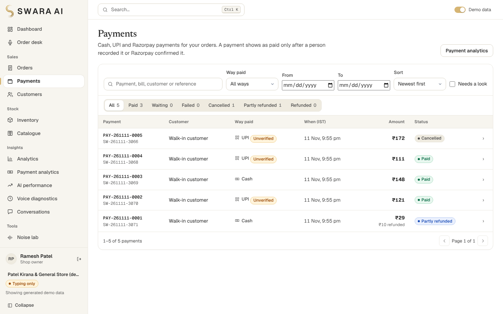{ width=100% }

**What this module does not cover.** No payment went through Razorpay, in test or live mode, and no real UPI app, bank or card was involved, so every Razorpay behaviour described here is from the code and a stand-in. The webhook endpoint is public by necessity: it is protected by its signature check but is not rate limited, and a proxy limit should sit in front of it on a reachable server. There is no GST invoice, no multi-shop accounting and no reconciliation against a bank statement. `docs/PAYMENT_SECURITY_AUDIT.md`, `docs/PAYMENTS_API.md` and `docs/RAZORPAY_SETUP.md` have the detail.

# 12. Dataset description

Every piece of data is one of four kinds, and the interface and files say which. Full provenance, licences and limits are in `docs/DATA.md`.

| Kind | What | Notes |
|---|---|---|
| **Sourced** | Open Food Facts India extract: 5,325 packaged products (barcode, brand, name, pack size, category) | ODbL 1.0 and DbCL 1.0. Snapshot of 5 July 2026, retrieved 10 November 2026 through a GitHub republication whose commit and checksum are recorded. **No prices.** |
| **Transformed** | Cleaned names, parsed pack sizes, shop categories, a deterministic 90/10 split into catalogue and held-out products | Each by a listed rule; the raw value is kept beside the cleaned one |
| **Curated** | 65 staples with names in three languages, spoken aliases, reorder levels | Written by hand. Their prices are placeholders, shown as "Demo price" |
| **Synthetic** | About 120 days (roughly 3,000) of orders and 8 placeholder customers, and the test sentences | Generated by a seeded script, labelled "Demo", removable with one switch. The payments in Section 11 were typed by a script on a throw-away database and are labelled the same way |

The evaluation uses four sentence sets. They differ in how independent they are of the parser, which decides what each one can show.

**Table 6. Evaluation datasets.**

| Dataset | Sentences | Order sentences | Languages | How it was made |
| --- | ---: | ---: | --- | --- |
| Handwritten sentences | 128 | 114 | gu, hi, hinglish, en | Written by the parser's author, with gold lines; includes 4 ambiguous and 10 non-order sentences |
| Templated sentences | 160 | 160 | gu, hi, hinglish, en | Generated from sentence templates over the staples |
| Authored sentences, all 11 languages | 70 | 70 | gu, hi, en, hinglish, mr, bn, ta, te, kn, ml, pa | Registry sample sentence plus the sentences of the language tests; for the 7 languages added in 2.3.0 authored with NO native-speaker review |
| Held-out branded products | 300 | 300 | gu, hi, hinglish, en | Templated from the names of 527 held-out Open Food Facts products; synthetic sentences, real product names |

*Source: evaluation_summary.json, keys datasets and branded; files eval/utterances.jsonl and eval/language_sentences.jsonl.*

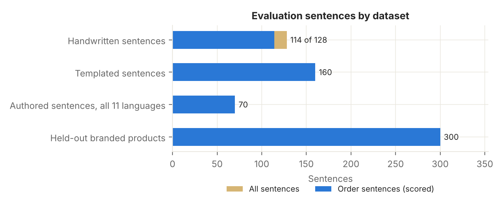{ width=100% }

*Figure 2. Evaluation sentences by dataset.* Count of all sentences and of the order sentences that are scored, per dataset. *Source: eval/results/evaluation_summary.json, key datasets and branded.*

What could not be done: Open Food Facts, Open Prices and data.gov.in were blocked in the build environment, so no observed prices were obtained. The retrieval route adds a licence question for the ODbL data that the project cannot settle; `docs/DATA.md` states it. Shop categories of imported products come from keyword rules. Because the demo orders are generated, every analytic is an exact sum over the database but says nothing about a real shop. A real shop's own orders replace them as they are taken.

# 13. Evaluation methodology

The single source of evaluation truth is `eval/results/evaluation_summary.json`, built by `scripts/build_evaluation_summary.py` from the sentence files and the code. A test rebuilds it and fails if the stored numbers differ from what the code now produces (apart from the timestamp and the timing measurements), so the AI Performance page and this report cannot show numbers that the code does not reproduce.

| Check | What is done | What it can show |
|---|---|---|
| Sentence check | Each sentence goes through the parser; the parsed lines must equal the gold lines (product, quantity, unit) | Agreement with the person who wrote the gold lines |
| Held-out brands | Sentences built from the names of 527 products not used to tune the matcher (10% of the public catalogue); the single returned product must be the expected one | Name recognition for unseen brands; an optimistic figure, since the sentences are built from the product name and never state a pack size |
| Language label | Each sentence is parsed with no language hint and the language label is compared with the true language | How often the parser's own language label is right |
| Typed end to end | The sentence, "that's all" and "confirm" go through the real dialogue against a throw-away shop; the stored order lines must equal the gold lines | The dialogue and the database together |
| Stock guard | The same orders are run against an empty shelf and a half-stocked shelf | That stock is never oversold |
| Simulated noise | Random deletions, substitutions and duplications of characters at 3, 6, 10 and 15% of characters, 5 random seeds each, on 114 order sentences | Sensitivity to spelling damage; **not** acoustic noise |
| Timing | Wall-clock time of the parser, and of local HTTP requests on one machine | Software speed; not speech speed |

**Metrics.** Precision, recall and F1 are used in their standard sense (Powers, 2011). For an order, a *line* is a (product, quantity, unit) triple. A returned line is a true positive if it equals a gold line. Precision is the share of returned lines that are right, recall is the share of gold lines that were returned, and F1 is their harmonic mean. *Whole order exact* is stricter: every line, and no extra line, must match. A *product-only* variant ignores quantity and unit.

**What a result is not.** None of these numbers comes from speech. Gold labels for the first four languages were written by the parser's author, so the sentence checks are best read as regression guards. Nothing here was measured on a real shop's customers. Where a metric needs live Gnani calls, the table says "Not measured".

# 14. Results

**Sentence sets.** On the handwritten set the engine matched 100.0% of its sentences exactly, on the templated set 100.0%, and on the authored set covering all eleven languages 100.0%. The first two are regression checks written by the same person as the parser. The authored set shows the parser agrees with its author in the added languages, which is not the same as being right for native speakers.

**Held-out brands.** Of 300 sentences, 244 resolved to exactly the right product (81.3%), 16 asked which pack was meant (5.3%), 21 were not recognised (7.0%), and 19 returned a wrong product (6.3%). Counting the two safe outcomes, 86.7% of sentences ended in the right product or a question. Figure 3 shows the split, and Figure 4 shows it per language.

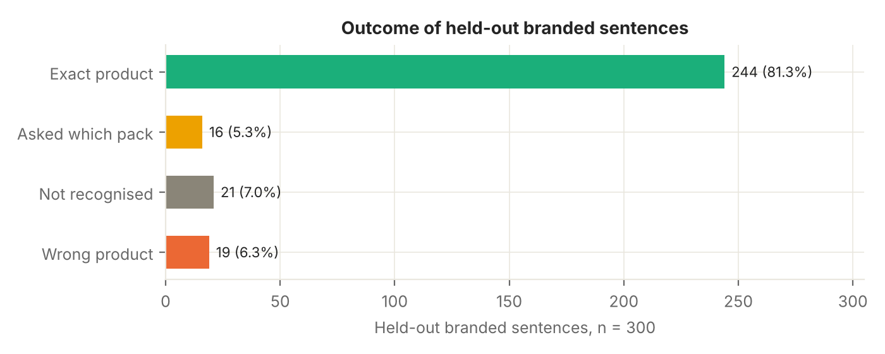{ width=100% }

*Figure 3. Outcome of held-out branded sentences.* The four possible outcomes with counts and shares. *Source: evaluation_summary.json, key branded.verdicts.*

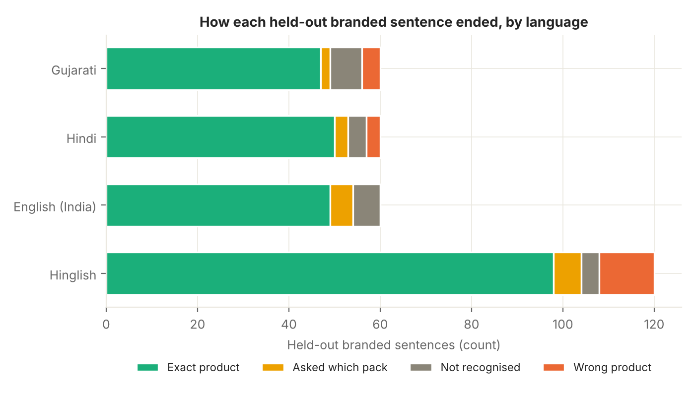{ width=100% }

*Figure 4. How each held-out branded sentence ended, by language.* Counts of the four outcomes for the 300 held-out branded sentences in the four original languages. *Source: evaluation_summary.json, key branded.by_language.*

**What the wrong products look like.** Table 7 lists every one. Reading it, about half are close to acceptable in a shop: asking for a specific brand's honey or a specific pack of a biscuit and getting a larger or generic pack of the same item ("Honey" to a 500 g honey pack, "Pure cow ghee" to "Ghee", "Classic Salted Potato Chips" to "Potato Chips"). The scoring counts them as wrong because the product is not the one the sentence was built from. The rest are genuine errors, mostly a spice or flour word that is shared between two products (a dal confused with another dal, gram flour matched to wheat flour, a papad matched to a dal). This classification is the author's reading of the table and is not part of the stored results.

**Table 7. Every wrong product returned for a held-out branded sentence.**

| Expected product | Product returned instead | Sentences |
| --- | --- | ---: |
| Parle G | Parle-G 100 g | 1 |
| Flavoured tea mix | Tea Leaves (250 g pack) | 1 |
| More Atta Bread | Wheat Flour (Atta) | 1 |
| CORIANDER POWDER KitchenFeast | Dhana Jeera Powder | 1 |
| 3 Roses Natural Care Tea | Tea Leaves (250 g pack) | 1 |
| Masoor dal | Toor Dal | 1 |
| Everest Rajma Masala | Rajma | 1 |
| Pure cow ghee | Ghee | 1 |
| Fresh paneer | Eggs | 1 |
| Super Strong Blend Coffee | Instant Coffee (50 g jar) | 1 |
| Good life chilli powder | Red Chilli Powder | 1 |
| Zero Maida Bread | Maida (Refined Flour) | 1 |
| Gram flour | Wheat Flour (Atta) | 1 |
| Organic brown sugar | Sugar | 1 |
| Moong Papad | Moong Dal | 1 |
| Good Life Ragi Flour | Wheat Flour (Atta) | 1 |
| Honey | Patanjali Honey 500 g | 1 |
| Classic Salted Potato Chips | Potato Chips | 1 |
| Good life black salt 200g | Salt | 1 |

*Source: evaluation_summary.json, key branded.confusion.wrong_pairs.*

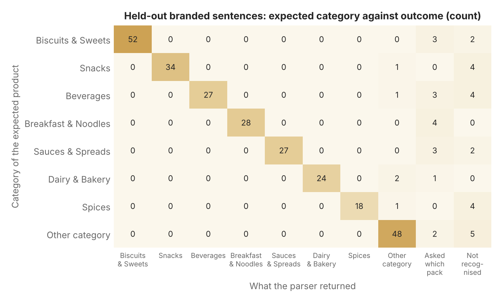{ width=100% }

*Figure 5. Expected category against outcome for held-out branded sentences.* Rows are the category of the product the sentence asked for; columns are the category of the product the parser returned, or one of the two safe outcomes. Off-diagonal cells in a category column are wrong products. *Source: evaluation_summary.json, key branded.confusion.*

Figure 5 shows where the sentences went, by the category of the product they asked for. Almost every outcome is on the diagonal. The off-diagonal cells in the safe columns (asked which pack, not recognised) are concentrated in categories with many look-alike products (biscuits, snacks, beverages and spices), which is where asking is the right behaviour.

**Typed orders end to end.** Of 344 sentences, 340 could be scored (the other 4 have gold lines that cannot be written as an order, such as an ambiguous request) and 340 of them produced exactly the gold order; 0 produced a wrong order. In the stock-guard runs, 84 of 84 orders against an empty shelf were refused and 82 of 84 orders against a half-stocked shelf were offered the remaining stock (2 were refused); 0 runs ended with negative stock.

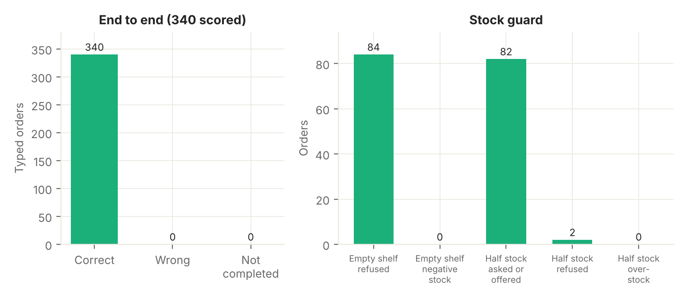{ width=100% }

*Figure 6. End-to-end typed orders and the stock guard.* Left: outcome of sentences taken through the dialogue to a saved order. Right: what happened when the same orders met an empty shelf or half the needed stock. *Source: evaluation_summary.json, key end_to_end.*

**Language labels.** With no language hint, 645 of 648 sentences (99.5%) received the correct label. The mistakes are where they should be: Marathi sentences labelled Hindi (shared script) and one Hinglish sentence labelled English (shared letters). Figure 7 is the full matrix.

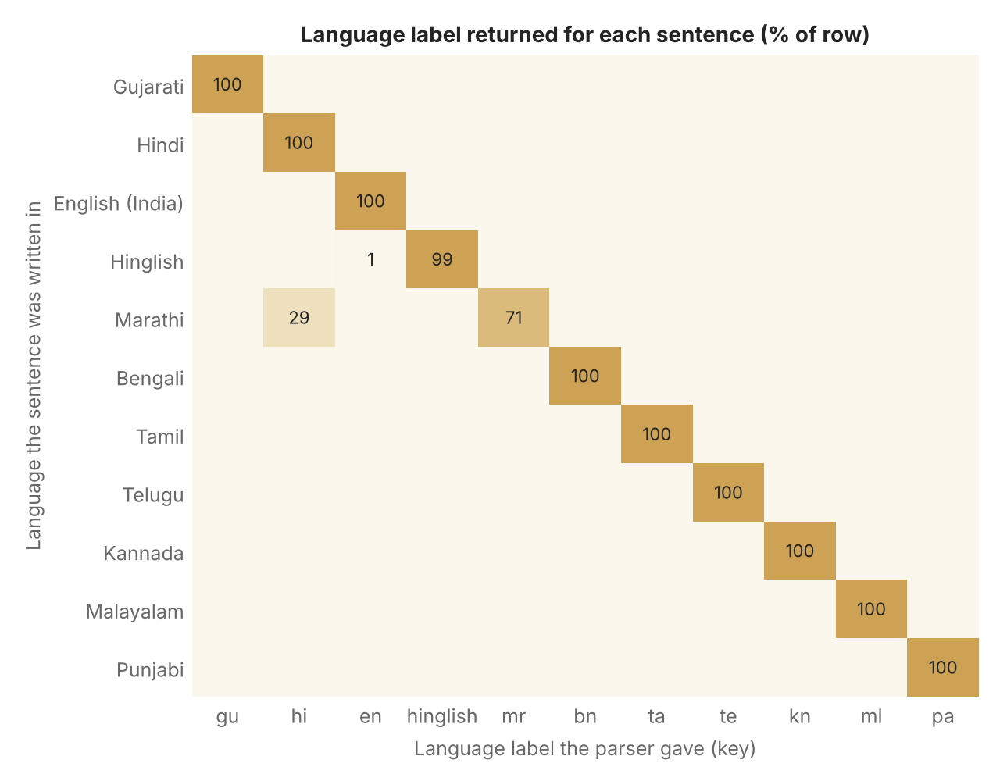{ width=100% }

*Figure 7. Language label returned for each sentence.* Confusion matrix of the language the parser reported against the language the sentence was written in, as a share of each row. *Source: evaluation_summary.json, key language_detection.*

**Language by sentence set.** Figure 8 puts every language against every sentence set. Cells show exact order match, which for the held-out brand set is the share of sentences resolved to the right product.

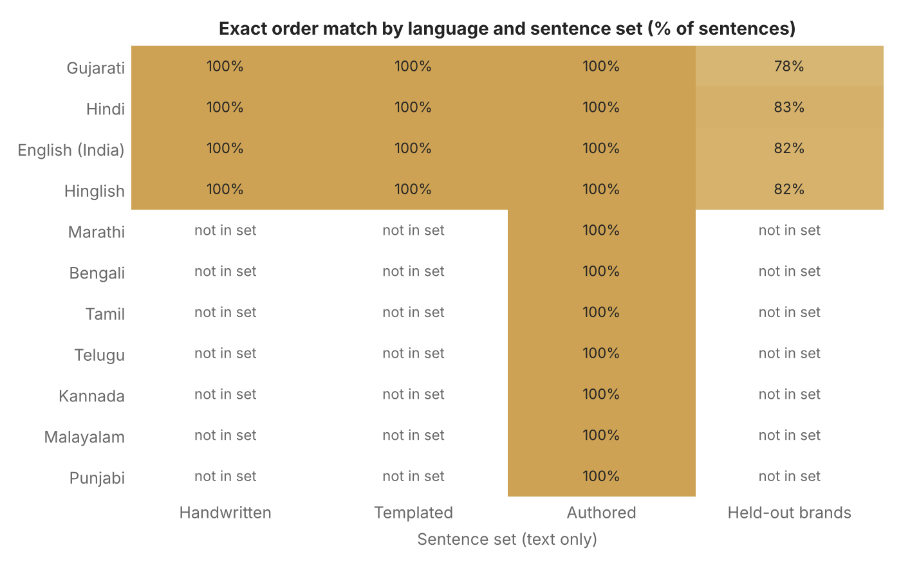{ width=100% }

*Figure 8. Exact order match by language and sentence set.* Share of sentences for which every parsed line (product, quantity, unit) equals the gold lines. Empty cells are sets that do not contain that language. *Source: evaluation_summary.json, key sentence_check.*

**Robustness to damaged text.** The full system keeps 78.6% of whole orders exactly right at 3% damage and 63.3% at 6%. The ablation (Figure 10) switches the matching stages on one after another: at 6% damage whole-order accuracy rises from 53.9% with exact matching alone to 63.3% with all stages. The phonetic skeleton and the fuzzy stage each add something; the case-ending stage adds nothing on this set, which holds only the four original languages, whereas that stage is aimed at the languages added later. The design turns weak matches into questions rather than wrong bills, but this measure counts those as misses. **Acoustic noise was not measured**: that needs recordings and live calls.

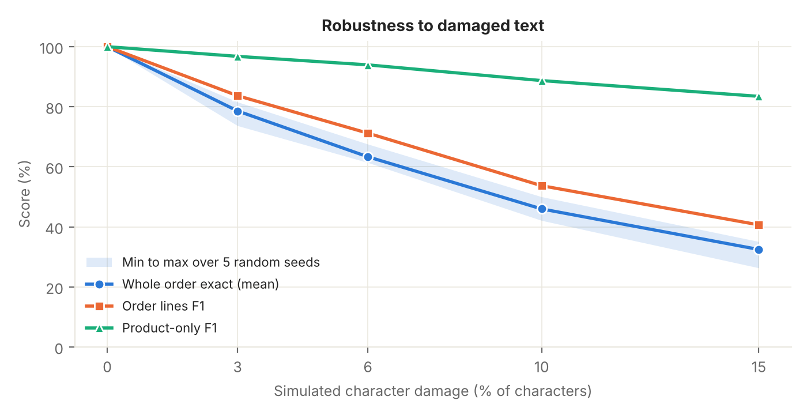{ width=100% }

*Figure 9. Robustness to damaged text.* Score against the share of characters randomly damaged, with the spread over random seeds for the whole-order measure. *Source: evaluation_summary.json, key noise.levels.*

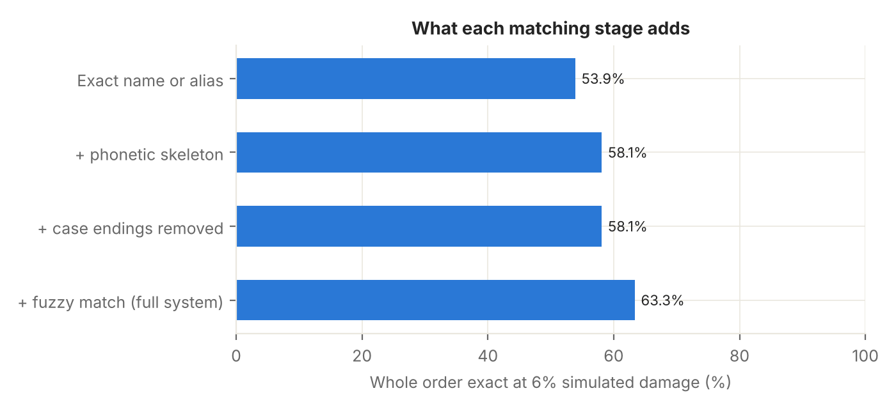{ width=100% }

*Figure 10. What each matching stage adds at 6% damage.* Whole-order accuracy as matching stages are switched on one after another. *Source: evaluation_summary.json, key noise.ablation.*

**Speed.** The parser alone takes a median of 0.138 ms and a 95th percentile of 0.213 ms per sentence (1,440 timings). Local HTTP requests on the build machine took a median of 7.1 ms for an order turn and 12.62 ms to confirm an order and take stock (95th percentiles 9.73 ms and 17.07 ms). These are software speeds on one machine (Linux 6.18.44-fc-v378 Python 3.13.18) with no Gnani call. Real voice latency includes the network and Gnani's processing and has not been measured. The parser timing comes from the 2.7.0 evaluation build. The HTTP timings were measured on the 2.6.0 backend, on a database of 3,101 orders, and **were not repeated for 2.7.0**, which adds a payment summary to order lists and the payment routes; those routes were not benchmarked at all.

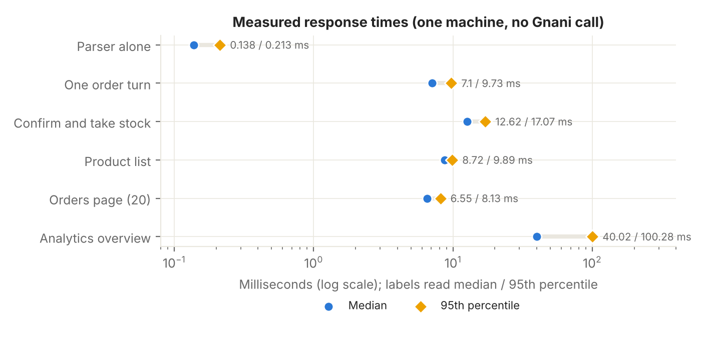{ width=100% }

*Figure 11. Measured response times.* Median and 95th percentile of the parser alone and of local HTTP requests, on a logarithmic axis because the values differ by orders of magnitude. The parser timing is from the 2.7.0 evaluation build; the HTTP timings were measured on the 2.6.0 backend and not repeated for 2.7.0. *Source: evaluation_summary.json parser_latency; eval/results/api_latency.json.*

# 15. Metrics

**Table 8. AI evaluation metrics.**

| Metric | Result | Dataset | Method | Interpretation |
| --- | --- | --- | --- | --- |
| Exact order match, handwritten sentences | 100.0% (114 of 114) | handwritten set | Every parsed line must equal the gold lines | Written by the parser's author: a ceiling, not a forecast |
| Exact order match, templated sentences | 100.0% (160 of 160) | templated set | Every parsed line must equal the gold lines | Generated from templates over the staples |
| Exact order match, authored sentences, 11 languages | 100.0% (70 of 70) | authored set | Every parsed line must equal the gold lines | Seven languages have no native-speaker review |
| Held-out brands: exact product | 81.3% (244 of 300) | Held-out branded sentences | The single product returned must be the expected one | Optimistic: sentences are built from the product name and never name a pack size |
| Held-out brands: wrong product | 6.3% (19 of 300) | Held-out branded sentences | One product returned and it is not the expected one | The costly error; listed pair by pair in the report |
| Held-out brands: asked which pack | 5.3% (16 of 300) | Held-out branded sentences | Several plausible products; the right one is among the options offered | Safe: the shopkeeper chooses |
| Held-out brands: not recognised | 7.0% (21 of 300) | Held-out branded sentences | No product returned | Safe: becomes a question |
| Typed order end to end | 340 of 340 correct | All 344 sentences, 11 languages | Sentence, "that's all", "confirm" through the real dialogue; stored lines must equal gold | 4 sentences whose gold cannot be written as an order are not scored |
| Stock guard, empty shelf | 84 of 84 refused; 0 negative stock | Orders from the end-to-end set | Every needed item at zero stock | No order may be created |
| Stock guard, half stock | 82 asked or offered, 2 refused; 0 over-stock orders | Orders from the end-to-end set | Half the needed quantity on the shelf | The assistant offers what is left |
| Noise 0%: whole order exact | 100.0% (range 100.0 to 100.0) | Handwritten order sentences x 5 seeds | Random character damage; the whole order must equal gold | Simulated typing damage, not acoustic noise |
| Noise 3%: whole order exact | 78.6% (range 73.7 to 81.6) | Handwritten order sentences x 5 seeds | Random character damage; the whole order must equal gold | Simulated typing damage, not acoustic noise |
| Noise 6%: whole order exact | 63.3% (range 61.4 to 67.5) | Handwritten order sentences x 5 seeds | Random character damage; the whole order must equal gold | Simulated typing damage, not acoustic noise |
| Noise 10%: whole order exact | 46.0% (range 42.1 to 50.0) | Handwritten order sentences x 5 seeds | Random character damage; the whole order must equal gold | Simulated typing damage, not acoustic noise |
| Noise 15%: whole order exact | 32.5% (range 26.3 to 35.1) | Handwritten order sentences x 5 seeds | Random character damage; the whole order must equal gold | Simulated typing damage, not acoustic noise |
| Parser time per sentence | p50 0.138 ms, p95 0.213 ms | 1440 timings | Wall-clock time of the parser alone | Excludes speech and the network |
| Server response, one order turn | p50 7.1 ms, p95 9.73 ms | 100 requests, Linux 6.18.44-fc-v378 Python 3.13.18 | Local loopback HTTP, signed in, throw-away database | One machine, one process; measured on the 2.6.0 backend and not repeated for 2.7.0; not what a shop on a real network sees |
| Speech recognition time (Prisma) | Not measured | None | Would need live Gnani calls | No live call has been made |
| Speech synthesis time (Timbre) | Not measured | None | Would need live Gnani calls | No live call has been made |
| Word error rate | Not measured | None | Needs recorded speech with reference transcripts and live calls | No such recordings exist in this project |

*Source: evaluation_summary.json and eval/results/api_latency.json.*

Table 8 is also shown on the AI Performance page. It is built from the same file, so the page and the report agree.

Precision, recall and F1 under simulated damage, which is how the evaluation reports the order-line quality of the full system:

**Table 9. Precision, recall and F1 under simulated text damage.**

| Simulated damage | Order-line precision | Order-line recall | Order-line F1 | Product precision | Product recall | Product F1 | Whole order exact |
| ---: | ---: | ---: | ---: | ---: | ---: | ---: | ---: |
| 0% | 1.000 | 1.000 | 1.000 | 1.000 | 1.000 | 1.000 | 1.000 |
| 3% | 0.861 | 0.815 | 0.837 | 0.995 | 0.942 | 0.968 | 0.786 |
| 6% | 0.743 | 0.684 | 0.712 | 0.980 | 0.903 | 0.940 | 0.633 |
| 10% | 0.580 | 0.500 | 0.537 | 0.958 | 0.826 | 0.887 | 0.460 |
| 15% | 0.461 | 0.364 | 0.407 | 0.947 | 0.746 | 0.835 | 0.325 |

*Source: evaluation_summary.json, key noise.levels.*

At 6% damage, precision is 0.743, recall 0.684 and F1 0.712. Precision stays above recall because the system prefers to add nothing rather than add something doubtful, so damaged text mostly costs missed lines, not wrong ones.

# 16. Graphical analysis

The figures in this report are produced by `scripts/build_report.py` from the stored result files. They follow the same rules as the app's charts: restrained colours drawn from the brand palette, titles, axis labels with units, direct value labels where there is room, no three-dimensional effects and no dual axes (orders and revenue are drawn as two panels that share the day axis). Every chart in the app also has a table view.

**The demo shop.** The figures below show the generated demo orders plus a short scripted session (`scripts/demo_activity.py`) that placed 6 real typed orders through the order desk, restocked two items, cancelled one order and imported 4 products from the public catalogue, against a throw-away database; the payments taken on those orders are in Section 11. They illustrate the dashboards; they say nothing about any real shop.

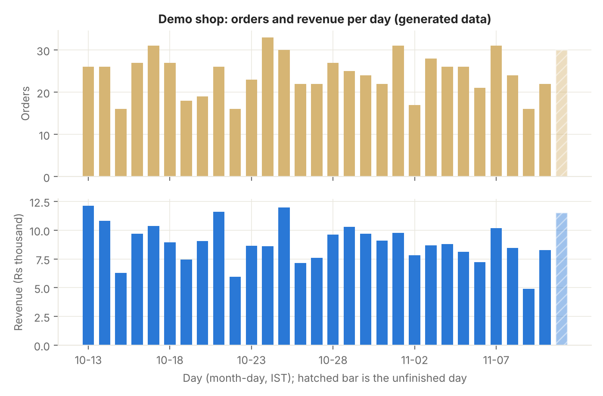{ width=100% }

*Figure 12. Demo shop, orders and revenue per day.* Generated demo orders over the last 30 days (not real sales). *Source: docs/report-data/demo_activity.json, overview.sales_by_day.*

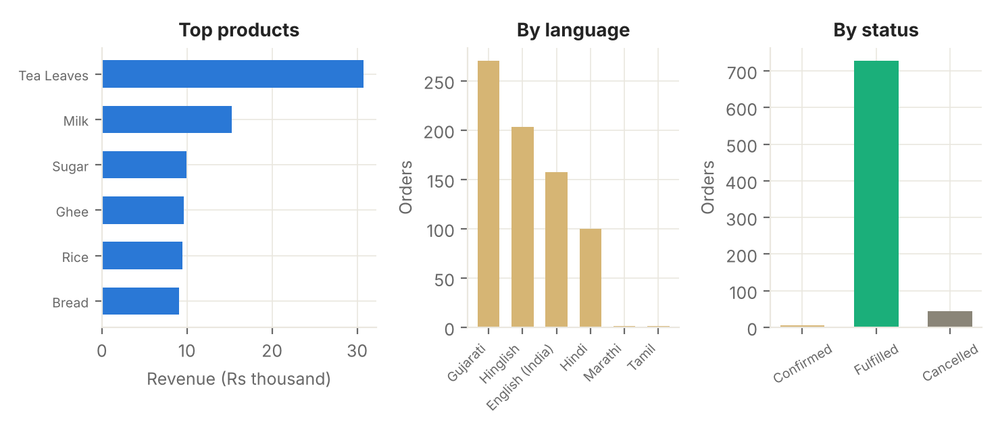{ width=100% }

*Figure 13. Demo shop, top products, language and status mix.* Revenue of the six best sellers, orders by language, and orders by status, from generated demo orders plus the six typed orders placed by scripts/demo_activity.py. *Source: docs/report-data/demo_activity.json, overview.*

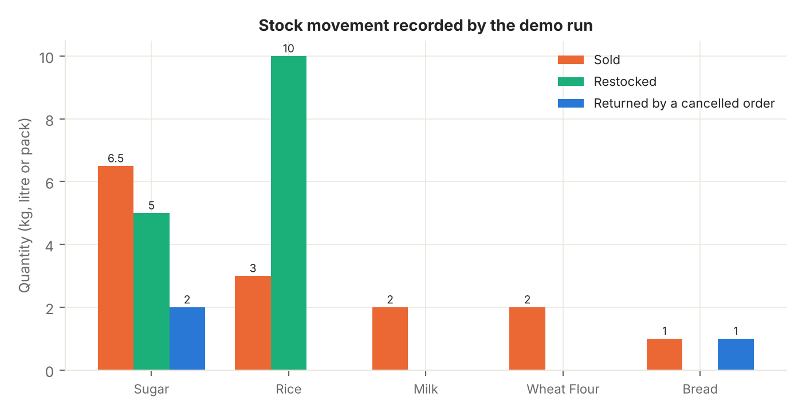{ width=100% }

*Figure 14. Stock movement recorded by the demo run.* Quantities sold, restocked and returned for the products touched by six typed orders, two restocks and one cancellation. *Source: docs/report-data/demo_activity.json, stock_movement.*

The 30-day window of the demo shop holds 732 orders with revenue of Rs 268,678.25 and an average basket of Rs 367.04. The stock ledger of the scripted session recorded 15 movements across 5 products: Rs 947.00 of stock in (restocks and returns from the cancelled order) and Rs 718.00 out (sales), valued at the shop's prices.

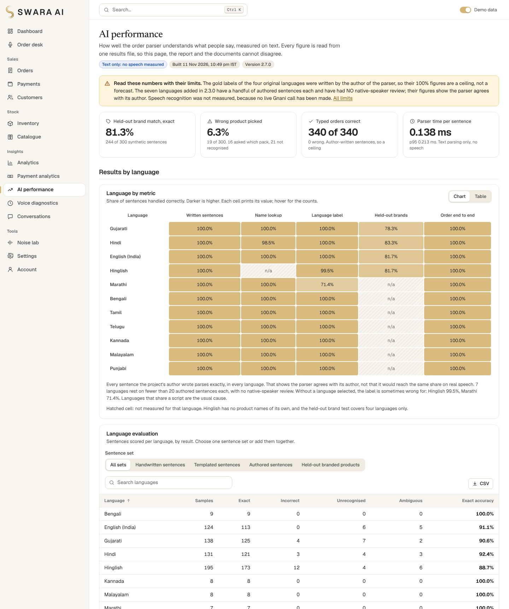

# 17. Tables and comparisons

The tables below show what the shopkeeper sees. All values come from the demo shop and the scripted session described above; prices are placeholders ("Demo price") except where a product was imported with a price typed for the demo.

**Table 10. Product catalogue of the demo shop (sample).**

| Product | Brand | Category | Pack size | Unit price | Stock | Status |
| --- | --- | --- | --- | ---: | ---: | --- |
| Almonds | - | Dry Fruits | sold loose | Rs 950.00 (demo price) | 2 kg | Low stock |
| Basmati Rice | - | Grains & Flour | sold loose | Rs 120.00 (demo price) | 60 kg | In stock |
| Bath Soap | - | Household | sold loose | Rs 38.00 (demo price) | 100 pc | In stock |
| Besan (Gram Flour) | - | Grains & Flour | sold loose | Rs 95.00 (demo price) | 35 kg | In stock |
| Bread | - | Dairy & Bakery | sold loose | Rs 45.00 (demo price) | 35 pack | In stock |
| Brinjal (Eggplant) | - | Vegetables | sold loose | Rs 50.00 (demo price) | 20 kg | In stock |
| Butter (100 g pack) | - | Oil & Ghee | sold loose | Rs 58.00 (demo price) | 40 pack | In stock |
| Cauliflower | - | Vegetables | sold loose | Rs 40.00 (demo price) | 0 kg | Out of stock |
| Chana Dal | - | Pulses | sold loose | Rs 90.00 (demo price) | 40 kg | In stock |
| Cold Drink (750 ml bottle) | - | Beverages | sold loose | Rs 40.00 (demo price) | 60 pc | In stock |
| Cream Biscuits | - | Snacks | sold loose | Rs 30.00 (demo price) | 60 pack | In stock |
| Cumin Seeds (Jeera) | - | Spices | sold loose | Rs 420.00 (demo price) | 10 kg | In stock |
| Amul Cow Ghee 500 ml | Amul | Oil & Ghee | 0.5 l | Rs 620.00 (shop price) | 6 pack | In stock |
| Maggi 2 - Minute Noodles 70 g | Maggi | Breakfast & Noodles | 0.07 kg | Rs 14.00 (shop price) | 40 pack | In stock |
| Parle 20-20 Nice - sugar sprinkled coconut biscuits 500 g | Parle | Biscuits & Sweets | 0.5 kg | Rs 10.00 (shop price) | 24 pack | In stock |
| TATA Salt Himalayan Rock Salt 500 g | TATA Salt | Sugar, Salt & Tea | 0.5 kg | Rs 28.00 (shop price) | 30 pack | In stock |

*Source: docs/report-data/demo_activity.json, inventory. Demo data: prices are placeholders; the last four rows were imported from the public catalogue at prices typed for the demo.*

**Table 11. Orders of the demo shop (latest twelve).**

| Order | Customer | Products and quantities | Units | Total | Language | Status | When (UTC) |
| --- | --- | --- | ---: | ---: | --- | --- | --- |
| SW-261111-3071 | Walk-in customer (typed in the demo run) | Rice x 0.5 kg | 0.5 | Rs 29.00 | ta | Confirmed | 11 Nov 17:24 |
| SW-261111-3070 | Walk-in customer (typed in the demo run) | Sugar x 2 kg, Rice x 0.5 kg | 2.5 | Rs 121.00 | mr | Confirmed | 11 Nov 17:24 |
| SW-261111-3069 | Walk-in customer (typed in the demo run) | Sugar x 2 kg, Milk x 1 l | 3 | Rs 148.00 | gu | Confirmed | 11 Nov 17:24 |
| SW-261111-3068 | Walk-in customer (typed in the demo run) | Wheat Flour (Atta) x 2 kg, Sugar x 0.5 kg | 2.5 | Rs 111.00 | hi | Confirmed | 11 Nov 17:24 |
| SW-261111-3067 | Walk-in customer (typed in the demo run) | Sugar x 2 kg, Bread x 1 pack | 3 | Rs 137.00 | en | Cancelled | 11 Nov 17:24 |
| SW-261111-3066 | Walk-in customer (typed in the demo run) | Rice x 2 kg, Milk x 1 l | 3 | Rs 172.00 | hinglish | Confirmed | 11 Nov 17:24 |
| SW-261111-3051 | Demo Customer B (demo) | Milk x 0.5 l, Wheat Flour (Atta) x 5 kg | 5.5 | Rs 248.00 | gu | Cancelled | 11 Nov 15:03 |
| SW-261111-3036 | Demo Customer A (demo) | Rice x 5 kg, Cold Drink (750 ml bottle) x 6 pc, Packaged Water (1 L bottle) x 1 pc, Instant Coffee (50 g jar) x 3 pack, Peanuts x 1 kg, Eggs x 3 pc | 19 | Rs 1,206.00 | en | Fulfilled | 11 Nov 14:28 |
| SW-261111-3053 | Demo Customer G (demo) | Tea Leaves (250 g pack) x 4 pack, Semolina (Suji) x 1.5 kg, Peanuts x 3 kg, Milk x 3 l | 11.5 | Rs 1,146.00 | gu | Fulfilled | 11 Nov 14:24 |
| SW-261111-3052 | Demo Customer B (demo) | Tomato x 2 kg, Semolina (Suji) x 2 kg | 4 | Rs 184.00 | gu | Fulfilled | 11 Nov 13:52 |
| SW-261111-3050 | Demo Customer C (demo) | Butter (100 g pack) x 6 pack, Glucose Biscuits x 2 pack, Tea Leaves (250 g pack) x 2 pack, Dishwash Bar x 2 pc | 12 | Rs 628.00 | gu | Fulfilled | 11 Nov 13:52 |
| SW-261111-3044 | Demo Customer F (demo) | Butter (100 g pack) x 2 pack, Cold Drink (750 ml bottle) x 3 pc, Milk x 0.25 l, Potato x 1 kg, Poha (Flattened Rice) x 2 kg | 8.25 | Rs 402.00 | gu | Fulfilled | 11 Nov 13:40 |

*Source: docs/report-data/demo_activity.json, orders. Rows marked (demo) are generated; the others were typed through the order desk by scripts/demo_activity.py.*

**Table 12. Inventory performance of the demo run.**

| Product | Opening | Added | Returned | Sold | Current | Reorder status |
| --- | ---: | ---: | ---: | ---: | ---: | --- |
| Sugar | 100 | 5 | 2 | 6.5 | 100.5 | OK |
| Rice | 120 | 10 | 0 | 3 | 127 | OK |
| Milk | 90 | 0 | 0 | 2 | 88 | OK |
| Wheat Flour (Atta) | 150 | 0 | 0 | 2 | 148 | OK |
| Bread | 35 | 0 | 1 | 1 | 35 | OK |

*Source: docs/report-data/demo_activity.json, stock_movement (read from the stock ledger; opening = current minus net movements).*

The languages table in Section 9 and the technology table in Section 6 are the language-evaluation and technology-stack tables of the evaluation; the metrics table is in Section 15, the payment tables are in Section 11 and the test record is in Section 19.

# 18. Security

The review covered accounts and sessions, authorisation, input handling, secrets and data exposure, stock and order integrity, and configuration. `docs/SECURITY.md` has the detail, including the thirteen known risks that were left on purpose and why, and `docs/PAYMENT_SECURITY_AUDIT.md` covers the payment module.

| Area | What the code does | How it is checked |
|---|---|---|
| Passwords | scrypt hashes (RFC 7914) with a per-password salt; constant-time comparison; one message for a wrong password and an unknown address | Account tests |
| Sessions | A random secret in an HttpOnly, SameSite cookie (RFC 6265), stored on the server only as a hash, with a per-session CSRF token and an Origin check; 12-hour or 2-hour idle expiry, 30 days if the person asks to stay signed in | Session and CSRF tests; a real-browser sign-out and expiry run |
| Lock-out and rate limits | An address is locked out for 15 minutes after repeated wrong passwords; per-IP rate limits | Tests |
| Authorisation | The first account is the owner; everyone else is staff. The server returns 403 for staff on owner-only actions, and 401 on every API route when not signed in except a short list of deliberately public endpoints | A test walks the route table; the browser run checks roles |
| Input | Validation of every request body; SQL through the ORM with bound parameters; script text and SQL injection strings are stored and returned as data | Injection tests |
| Output | Secure response headers; a uniform error envelope; a server error shows no traceback, file path or key | A leakage test forces a server error |
| Secrets | The Gnani key is in `.env` on the server, masked in the settings API, never in a GET response, a log or a screenshot | Tests assert it appears nowhere |
| Uploads | Size, duration and magic-byte checks; a renamed file is rejected | Upload tests |
| Exports | CSV cells that start with a formula character are prefixed so a spreadsheet does not run them | CSV tests |
| Orders and stock | Guarded stock update with compensation; ledger rows in the same commit; repeated confirm creates no second order; stock never negative | Integrity tests, including two simultaneous confirmations |
| Payments | The amount is read from the server; a payment is marked paid only by a person who recorded it or by Razorpay's confirmation (valid signature and a lookup that agree on amount, currency and order); duplicates are blocked by database rules; refunds, payment analytics and the UPI settings are owner only | Payment tests, a route-table test and a secrets test, all against a stand-in for Razorpay |
| Razorpay secrets and webhook | Secrets only in `.env`, never returned, shown or logged; the webhook needs a valid signature over the raw body, each event is processed once, and it is refused outright while no webhook secret is set | The same tests; **never exercised against the real service** |
| Dependencies | `npm audit` and `pip-audit` run for this release; one front-end dependency was added in 2.7.0 and the backend requirements are unchanged | Section 19 |

OWASP's Application Security Verification Standard was used as a checklist of things to look at. This is not an audit against it and the project holds no security certification. The thirteen known risks in `docs/SECURITY.md` include open sign-up by default, in-memory lock-out counters, no two-factor sign-in no external security review and, for payments, a public webhook endpoint that is protected by its signature but not rate limited. Separately, protection against two confirmations arriving at the same moment holds because the server is one process handling requests one after another; running several worker processes would need a version column on the session row first.

# 19. Testing

All counts below were produced by running the suites for this release and reading their saved logs (`docs/test-results/`). The table is rebuilt from those logs by `scripts/build_verification_summary.py`, and the AI Performance page shows the same table.

**Table 13. Test and verification record.**

| Category | Total | Passed | Failed | Skipped | Status | How and when it ran |
| --- | ---: | ---: | ---: | ---: | --- | --- |
| Accounts, sessions and security | 223 | 223 | 0 | 0 | Passed | Sign-up, sign-in, CSRF, route guard, rate limits, injection strings, uploads, order integrity. Executed in this environment (Linux), log saved 2026-11-11 15:54 UTC |
| Order parser and dialogue | 438 | 438 | 0 | 0 | Passed | Quantities, units, products, branded packs, confirmation flow, noise, 11 languages. Executed in this environment (Linux), log saved 2026-11-11 15:54 UTC |
| Gnani client (mocked HTTP, not live) | 40 | 40 | 0 | 0 | Passed | Request shapes, headers, error handling and key secrecy against a mock server. Executed in this environment (Linux), log saved 2026-11-11 15:54 UTC |
| Shop API, data and evaluation files | 127 | 127 | 0 | 0 | Passed | Products, inventory, orders, analytics, seed data, stock movement, evaluation summary. Executed in this environment (Linux), log saved 2026-11-11 15:54 UTC |
| Voice path, diagnostics and update safety (2.6) | 53 | 53 | 0 | 0 | Passed | Pooled Gnani connection, time limits and retries, reply first and voice after, stage timing, owner-only diagnostics, the .env and database kept on update (mocked Gnani, not live). Executed in this environment (Linux), log saved 2026-11-11 15:54 UTC |
| Payments, refunds, invoices and migration (2.7, Razorpay simulated) | 158 | 158 | 0 | 0 | Passed | Cash, hand-confirmed UPI, Razorpay against a stand-in, signatures and webhooks, duplicates, refunds, permissions, the additive migration, secrets (no real Razorpay call). Executed in this environment (Linux), log saved 2026-11-11 15:54 UTC |
| Branding, wording and Windows scripts | 64 | 64 | 0 | 0 | Passed | Product name, light theme only, landing-page claims, script structure (cmd.exe itself was not run). Executed in this environment (Linux), log saved 2026-11-11 15:54 UTC |
| Front-end tests | 513 | 513 | 0 | 0 | Passed | Components, pages, tables, charts and helpers in jsdom (Vitest); includes the shipped evaluation file contract. Executed in this environment (Linux), log saved 2026-11-11 16:28 UTC |
| Front-end build | 1 | 1 | 0 | 0 | Passed | tsc --noEmit (type-check) then vite build (npm run build). Executed in this environment (Linux), log saved 2026-11-11 16:28 UTC |
| Real-browser end-to-end checks | 221 | 221 | 0 | 0 | Passed | Chromium on a fresh database: sign-up, order desk, payments and invoices, every page, 20 pages and the payment window at 7 widths, console errors. Executed in this environment (Linux), log saved 2026-11-11 16:34 UTC |
| Real-browser control sweep | 4 | 4 | 0 | 0 | Passed | Every enabled button and link on the visitor and owner pages. Executed in this environment (Linux), log saved 2026-11-11 16:25 UTC |
| Dependency audits | 2 | 2 | 0 | 0 | Passed | npm audit (front end) and pip-audit (back end); advisory databases change daily. Executed in this environment (Linux), log saved 2026-11-11 16:11 UTC |
| Parser regression check | 288 | 288 | 0 | 0 | Passed | 288 held-out sentences in 4 languages parsed and compared with their gold lines (scripts/evaluate_nlu.py). Executed in this environment (Linux), log saved 2026-11-11 16:34 UTC |
| Stock guard | 168 | 168 | 0 | 0 | Passed | Every order sentence replayed against an empty shelf and a half-stocked shelf; no stock may go negative. Executed in this environment (Linux), log saved 2026-11-11 17:19 UTC |
| Live Gnani verification | - | - | - | - | Not run | Real Gnani calls: speech synthesis, language code and speech recognition per language (python scripts/verify_gnani.py, about 33 calls). Needs a Gnani API key and network access, which this environment does not have |
| Razorpay against the real service (test mode) | - | - | - | - | Not run | Create an order, open Checkout, receive a signed webhook and make a refund with your own Razorpay TEST keys (docs/RAZORPAY_SETUP.md). This environment has no Razorpay account and no route to Razorpay; every Razorpay test uses a stand-in written from Razorpay's public documentation as remembered while building, not checked against a live account |
| Windows scripts run on Windows | - | - | - | - | Not run | setup.bat, start.bat, dev.bat, test.bat, verify_gnani.bat run by cmd.exe. cmd.exe is not available here; the scripts were read and their structure is tested (see Branding, wording and Windows scripts) |

*Source: eval/results/verification_summary.json, counted from the saved test logs.*

For this build, the backend suite ran 1,103 tests: 1,103 passed, 0 failed and 0 were skipped (158 of them are the payment tests), with 95% of 6,349 statements executed. The front-end suite ran 513 tests in 50 files (513 passed). The real-browser end-to-end run passed 221 of 221 checks, including the payment window, payments, refunds and invoices, and the control sweep (a click on every button and link of the signed-in pages) 4 of 4. The parser regression check passed 288 of 288. Updating a real 2.6.0 install in place, with its own data, passed 34 of 34 checks. The record was compiled on 2026-11-11.

**What was run, what was mocked, what was not run.**

| Evidence | Status |
|---|---|
| Backend, front-end, build, real-browser and parser checks listed above | **Executed for this release** |
| Gnani Prisma and Timbre client behaviour | **Mocked**: tests run against a simulator built from the documentation and against a fake streaming server. No real Gnani response was used |
| Razorpay orders, signatures, webhooks and refunds | **Mocked**: tests run against a stand-in that the author wrote from Razorpay's public documentation as remembered while building. No real Razorpay response was used, and the field names and endpoints were not checked against a live account |
| Razorpay against the real service in test mode | **Not run**: no Razorpay account and no route to Razorpay in the build environment. `docs/RAZORPAY_SETUP.md` explains how to do it with your own test keys |
| A real UPI app, bank or card; payments in a real shop | **Not run** |
| Update of a 2.6.0 install in place | **Executed** on Linux: 34 of 34 checks, with `.env` and the database untouched and every old row identical afterwards |
| Live Gnani calls, in any language | **Not run**: no key and no route to Gnani in the build environment |
| Real microphone capture | **Not run** |
| Windows scripts (`setup.bat`, `start.bat`, `dev.bat`, `test.bat`, `verify_gnani.bat`) | **Reviewed and structure-tested, not run on Windows**: tests check that every label a script jumps to exists, every file it points at exists, and that no script holds a key |
| Browsers other than Chromium; screen-reader and automated accessibility audit | **Not run** |

Testing found real defects in the product in each release, and `docs/TESTING.md` lists them all. In release 2.7.0 the real-browser run and a reading of the code found these in the payment screens: the payment window flashed its "choose a way" step while it reopened an unfinished payment; it accepted a cash amount that the server would then refuse, a typing slip of more than twenty times the bill; and several wordings were wrong ("not verified" shown twice on a hand-confirmed UPI payment, an "Unverified" badge on cash, the owner shown as staff on an invoice, and a test-mode note shown while no Razorpay keys were set). Each was fixed and has a test. In release 2.5.0 a brand's pack-less alias belonged only to the pack imported first, so a sentence quietly became that pack (which moved the brand results reported in this document, from 252 exact, 25 wrong and 2 asked-which-pack to the figures above), and the new AI performance page scrolled sideways on a phone. The review of the order and security paths found no oversell or duplicate-order defect, and tests were added so that it stays that way. Earlier releases fixed a `Decimal` that could not be serialised in the streaming message, a UTC and IST mix-up that put the busiest hour at midnight, an in-progress day reported as a complete one, and several parser and layout defects. They are listed in `docs/TESTING.md` and `docs/VERIFICATION_REPORT.md`.

**Table 14. Local HTTP response times.**

| Request | Median (ms) | 95th percentile (ms) | Slowest (ms) | Requests |
| --- | ---: | ---: | ---: | ---: |
| One order turn | 7.1 | 9.73 | 64.65 | 100 |
| Confirm an order and take stock | 12.62 | 17.07 | 20.7 | 50 |
| Product list | 8.72 | 9.89 | 15.76 | 50 |
| Orders page, 20 rows | 6.55 | 8.13 | 9.02 | 50 |
| Analytics overview, 30 days | 40.02 | 100.28 | 106.05 | 50 |
| Stock movement, 30 days | 5.34 | 6.45 | 6.66 | 50 |
| Catalogue search | 8.52 | 10.38 | 21.36 | 50 |
| Search everything | 9.16 | 13.06 | 25.83 | 50 |
| Evaluation results file | 3.7 | 4.73 | 12.71 | 50 |

*Source: eval/results/api_latency.json (scripts/benchmark_api.py, throw-away database, no Gnani calls; measured on the 2.6.0 backend and not repeated for 2.7.0).*

# 20. Limitations

In order of importance (the full list is `docs/LIMITATIONS.md`):

1. **No live Gnani evidence.** Prisma, Timbre, real microphones and the Windows scripts are unverified here, for all eleven languages. Speech accuracy, word error rate, speech latency and acoustic-noise behaviour are not measured. The scripts to measure them are provided.
2. **No Razorpay evidence.** The Razorpay client was tested only against a stand-in that the author wrote from Razorpay's public documentation as remembered while building, so its field names and endpoints are unchecked against a live account. No payment, refund or webhook went through Razorpay in test or live mode; the first real test-mode payment is for the owner to make with their own test keys (`docs/RAZORPAY_SETUP.md`). A UPI QR payment is confirmed by a person and is never verified by a provider.
3. **Authored test sentences.** The gold sentences for the first four languages were written by the parser's author, and the seven added languages have no native-speaker review. The sentence checks are regression guards, not accuracy forecasts.
4. **Optimistic brand test.** Held-out brand sentences are built from product names and never state a pack size; real customers will do worse, and the wrong-product rate of 6.3% is the number to watch.
5. **No real prices.** The public catalogue has none. Demo prices are placeholders and inventory value is at selling price.
6. **Generated orders.** The demo's orders and customers are generated, so analytics describe nothing real until real orders exist.
7. **No model fallback.** Sentences the grammar does not cover become questions.
8. **Single process.** One shop, one till, one price per item. Double-confirm safety relies on one server process, and so do the lock-out counters. SQLite only has been run; PostgreSQL is untested.
9. **Invoices are receipts, not tax invoices.** No GST details are configured and no tax is calculated. The payment webhook is public and not rate limited, and the payment figures in this report come from a scripted session, not from a real shop.
10. **Accessibility and browsers.** No screen-reader or automated accessibility audit; only Chromium was used. Newsreader has no Indian-script glyphs, so headings in Gujarati or Hindi use the Noto face.
11. **Stock ledger gaps.** Orders seeded as demo data write no ledger rows, and the opening stock of a product imported from the catalogue is not in the ledger, so opening stock is derived (current minus net movements).

# 21. Future scope

- Run `verify_gnani.bat` and the noise scripts with a key, then publish measured word error rate by language and noise level, and compare the engine's results on real Prisma transcripts with the ones here.
- Have a native speaker of each added language review its pack and extend the sentence sets, then collect a blind test set of real recorded orders from people other than the author.
- Make the first real Razorpay test-mode payment, refund and signed webhook with your own test keys, then record the result next to the stand-in tests; add GST details only if a shop needs a tax invoice.
- Replace demo prices with real ones (shopkeeper entry, or open price data fetched on a machine with internet access) and add a purchase-cost field so margin can be reported.
- Add an optional model-based fallback for low-confidence lines, behind the same dialogue checks, if a suitable model becomes available.
- Natural spoken quantities in replies, customer credit accounts (*udhaar*), a migration framework beyond the one additive step, a PostgreSQL run, and a version column on sessions for multi-worker use.

# 22. Conclusion

SWARA AI shows that a voice-first ordering assistant for kirana stores can be built so that the language model of speech and the logic of money are separate, and so that the system asks instead of guessing. The measured results are good where they can be measured and plainly limited where they are not: the parser agrees with its authors, resolves most held-out brand sentences to the right product and turns most of the rest into questions, never oversold stock in any run, and degrades gradually as text is damaged. Release 2.7.0 adds payments on the same principle: the amount comes from the server, a payment counts as paid only on a person's record or Razorpay's confirmation, an unverified UPI payment says so, and no payment step touches stock. What the project cannot yet say is how it performs on real speech through Prisma, or how its Razorpay integration behaves against Razorpay itself. That needs a key, a microphone and recorded orders, and the repository contains the scripts to produce that evidence. Until then, the honest status of every language is "implemented and tested with mocked HTTP, not verified live", and the honest status of Razorpay is "implemented and tested against a stand-in, never run against the real service".

# 23. References

1. Gnani.ai. *Gnani AI documentation*: Prisma speech to text, Timbre text to speech, available voices, language codes. https://docs.gnani.ai, read 10 and 11 November 2026. SWARA AI is not affiliated with or endorsed by Gnani.ai.
2. Open Food Facts contributors. *Open Food Facts, India database*. https://in.openfoodfacts.org/, licensed under the Open Database Licence (ODbL) 1.0 and Database Contents Licence 1.0, https://opendatacommons.org/licenses/odbl/1-0/. Used through the `mvark/indiafoodstats` GitHub republication, commit `d3624c4e5b00d2e5aa6d9d3c4b0b24f82a7bbb5a`, retrieved 10 November 2026.
3. Powers, D. M. W. (2011). Evaluation: from precision, recall and F-measure to ROC, informedness, markedness and correlation. *Journal of Machine Learning Technologies*, 2(1), 37-63.
4. Levenshtein, V. I. (1966). Binary codes capable of correcting deletions, insertions and reversals. *Soviet Physics Doklady*, 10(8), 707-710.
5. Percival, C. and Josefsson, S. (2016). *The scrypt Password-Based Key Derivation Function*. RFC 7914. https://www.rfc-editor.org/rfc/rfc7914
6. Barth, A. (2011). *HTTP State Management Mechanism*. RFC 6265. https://www.rfc-editor.org/rfc/rfc6265
7. W3C. *Web Content Accessibility Guidelines (WCAG) 2.2*. https://www.w3.org/TR/WCAG22/ (used for the contrast and keyboard checks of the interface; no formal conformance claim is made).
8. OWASP. *Application Security Verification Standard*. https://owasp.org/www-project-application-security-verification-standard/ (used as a checklist; no verification level is claimed).
9. FastAPI. https://fastapi.tiangolo.com. SQLAlchemy. https://www.sqlalchemy.org. SQLite. https://www.sqlite.org.
10. React. https://react.dev. Vite. https://vite.dev. Vitest. https://vitest.dev. Recharts. https://recharts.github.io. Playwright. https://playwright.dev.
11. RapidFuzz. https://github.com/rapidfuzz/RapidFuzz.
12. Razorpay. *Razorpay documentation*: Orders, Checkout signature verification, Webhooks, Refunds. https://razorpay.com/docs/ . The integration's field names and endpoints were written from this public documentation as remembered while building and were not checked against a live account. SWARA AI is not affiliated with or endorsed by Razorpay.

*Development note.* This project was built with Claude (Anthropic) as an AI coding assistant. Reproducing the results: `docs/TESTING.md`; installation on Windows: `docs/INSTALLATION.md`; evidence for each claim: `docs/VERIFICATION_REPORT.md`.
